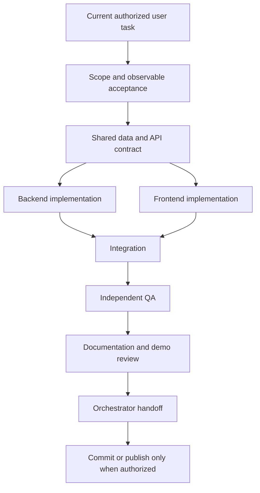

# Local team execution workflow

## Start a task

1. Read the user's current request, [project instructions](../AGENTS.md), relevant implementation guide and assigned role.
2. Define an observable result, exclusions, read inputs and exact writable files using the [task template](task-template.md).
3. Resolve dependencies before freezing contracts. One named owner changes shared schemas, package manifests or integration files.
4. Assign only useful ready parallel work within the available concurrency limit. Catalogue entries do not require simultaneous execution.
5. Complete each handoff with evidence; the orchestrator integrates and resolves disagreements.

## Dependency map

| Owner | Main dependencies | Handoff |
| --- | --- | --- |
| Product Manager | User vision and Business Analyst discovery | Priorities and bounded acceptance to all roles |
| Business Analyst | Product scope, Analytics and Security | Stories, rules and workflows to Architecture/UI/QA |
| Solution Architect | BA, Security, Database and Analytics | Component boundaries and interface decisions |
| UI/UX | Journeys, real data availability and visibility rules | Navigation, states and accessible layouts to Frontend |
| Database Architect | Business grain, source boundaries and metric needs | Entity/history/lineage definitions to Backend and Analytics |
| Analytics | BA eligibility and Database grain | Formulas, denominators, exclusions and reconciliation cases |
| Backend | Accepted contracts, architecture, data and policy | Validated APIs and behavior notes to Frontend/QA |
| Frontend | Backend schemas, UI/UX and Analytics | Working journeys, stable labels and state evidence |
| Reporting | Trusted metrics/snapshots and scope requirements | Report/extract/schedule design or authorized implementation |
| Security | Personas, trust boundaries and data classification | Concrete findings and enforcement requirements |
| QA | Independent acceptance criteria and implementation contract | Reproductions, tests, results and practical limits |
| DevOps | Runtime architecture, environment and security | Repeatable setup/build/demo and deployment guidance |
| Documentation | Verified domain handoffs and QA evidence | Current indexes, walkthroughs, assumptions and presentation claims |
| Orchestrator | All applicable handoffs | Integrated result and accurate final report |

Database/Analytics and Architecture/Security jointly resolve shared definitions instead of waiting in a circular queue.

## Typical implementation ownership

- Backend specialist: assigned API module; shared contracts only when explicitly owned.
- Frontend specialist: assigned feature components/services/styles; shared shell/routes only when explicitly owned.
- QA specialist: independent test files and assigned configuration; report implementation defects to their owner.
- Orchestrator: shared decisions, manifests when reserved, integration, final evidence and user communication.

An agent may propose changes outside its writable set but must hand them to the assigned owner. This prevents simultaneous edits to `App.tsx`, `app.ts`, shared schemas, package manifests and common UI components.

## Gates

A documentation-only request ends at reviewed documents and links; it does not enter the implementation branch.

## Verification ownership

Use `npm run check` for formatted source/configuration, strict types, API/UI tests and builds. Add targeted checks for the changed behavior. Do not create tests that merely restate formatting or mirror implementation details.

Browser verification needs exclusive control of its temporary servers: development scenarios use 5173/API3001; compiled-demo scenarios use 4173/API3001. Run one at a time and avoid an existing presenter session's ports. Reuse earlier successful evidence only when the relevant implementation has not changed, and label that evidence accurately.

The last project review recorded 125 automated tests and nine compiled-browser scenarios. Those figures are historical until a fresh run confirms them.

## Review and completion

QA findings return to the owner for correction and appropriate regression coverage. Documentation checks actual delivered scope rather than repeating the original target design. The orchestrator reports what changed, why, actual verification and remaining decisions. Proposed production controls, approved designs and implemented controls are distinct statuses.
