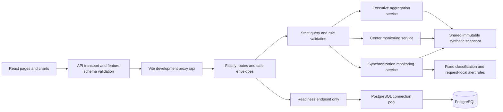

# Implemented architecture summary

**Project:** Sarthak Monitoring System. **Review date:** 2026-10-14. **Scope:** The running demonstration, reviewed against application source and shared contracts.

The implemented system has three monitoring modules: Executive Dashboard, Center Monitoring and Synchronization Monitoring. A React application calls a Fastify API, which derives all business responses from one immutable synthetic repository. PostgreSQL has environment configuration, a connection pool and a readiness check; it does not store or supply these monitoring records.

The broader architecture, authentication, RBAC, reporting and database design documents describe proposed future work. They do not establish that those components are implemented. [Known assumptions](known-assumptions.md) records the current data and metric limits.

## Runtime components

| Component | Implementation and responsibility |
| --- | --- |
| Web application | `apps/web`: React, TypeScript, Vite and Tailwind with feature-specific styles and chart components. Provides the executive dashboard, center directory/details and synchronization dashboard/target details. |
| Navigation | `App.tsx` selects pages from browser path and handles browser history changes. Center and synchronization listing filters/pagination are encoded in URLs; details preserve return context. |
| API client | Shared GET/POST transport checks success/error envelopes, passes cancellation signals and exposes safe failures. Feature services validate response data using shared Zod schemas. |
| Contracts | `packages/shared`: TypeScript types inferred from Zod schemas for dashboard, center and synchronization queries/responses, plus common API envelopes and error codes. |
| API application | `apps/api`: Fastify with request correlation, configured CORS origin, no-store headers, redacted structured logging, safe error handling, body limits and request timeout. |
| Executive service | Calculates scoped center status, scheme/category distribution, batch creation/enrollment cohort counts, weighted current utilization, sync health and historical synthetic trends. |
| Center service | Validates geographic relationships, searches and sorts centers, performs deterministic server pagination, returns analysis before status selection and exposes center history/batch/sync details. |
| Synchronization service | Returns expected-target evidence and classifications, summaries before state/result selection, deterministic alert pages and request-local rule evaluations. |
| Synthetic repository | The executive module creates one recursively frozen snapshot reused through injectable repository interfaces in all three services. There is no alternative center or synchronization seed. |
| Database adapter | A PostgreSQL pool supports `SELECT 1` readiness and clean shutdown. No business tables, ORM, migration runner or business writes are used by these modules. |

## Actual data flow

Business responses are recomputed from the fixed snapshot on each request. The API's response generation timestamp records when the response was created; the snapshot cutoff records when the invented source evidence is evaluated. Refresh does not ingest LMS events or advance the source cutoff.

The escalation editor submits custom rules through POST. The API validates them and returns an alert preview for that request. It does not save rules, modify health classification, create background jobs or send a notification.

## Implemented API surface

There are **17 business endpoints and two health endpoints**, for **19 routes** in total. Sixteen business endpoints are GET requests; the rule evaluator is the single business POST.

| Module | Routes |
| --- | --- |
| Executive: 7 GET | `/api/v1/dashboard/executive`, `/api/v1/dashboard/filters`, `/api/v1/dashboard/centers`, `/api/v1/dashboard/schemes`, `/api/v1/dashboard/batches`, `/api/v1/dashboard/sync`, `/api/v1/dashboard/trends` |
| Centers: 4 GET | `/api/v1/centers`, `/api/v1/centers/options`, `/api/v1/centers/analysis`, `/api/v1/centers/:id` |
| Synchronization: 5 GET | `/api/v1/synchronization/options`, `/api/v1/synchronization/dashboard`, `/api/v1/synchronization/targets/:id`, `/api/v1/synchronization/alerts`, `/api/v1/synchronization/rules` |
| Synchronization: 1 POST | `/api/v1/synchronization/rules/evaluate` |
| Health: 2 GET | `/api/health/live`, `/api/health/ready` |

Success responses use `{data, meta: {request_id, generated_at}}`; failures use the shared safe error envelope. Query validation rejects unsupported fields, invalid values and unknown scopes. Center/synchronization queries reject conflicting geographic parents. Unavailable snapshots and missing detail records return 404. Empty valid populations return empty results with unavailable percentages where denominators are zero.

These are public demonstration APIs. There is no authentication middleware, enforced role scope or session management. The CM/JDM/SDM/Super Admin escalation labels recommend recipients for a preview; they do not authorize API access.

## Local execution and hosting boundary

Npm workspaces build shared contracts before the API and web application. `npm run dev` starts contract watching, Fastify and Vite. The development web server binds to `127.0.0.1:5173` and proxies `/api` to the configured API origin, normally `127.0.0.1:3001`.

Monitoring can operate with PostgreSQL unavailable because the business repository is in memory. The API still requires valid environment configuration, including a PostgreSQL URL. `/api/health/ready` checks that database and can return 503 while monitoring endpoints succeed; `/api/health/live` does not check the database. Local Docker Compose provisions PostgreSQL 17 with a loopback port and persistent volume when explicitly started.

`npm run demo` builds the workspaces and serves the compiled API plus Vite preview on `127.0.0.1:4173`, with an explicitly configured local `/api` proxy. Page modules load lazily; React, validation and charts have separate build assets. This preview is a local presentation tool. A future hosting setup must serve the web application with SPA fallback and forward `/api` to Fastify, or configure an appropriate API URL and CORS origin. Repository configuration is not evidence of a deployed cloud environment. See [getting started](getting-started.md) and [Vite preview options](https://vite.dev/config/preview-options).

## Proposed future architecture

The [system architecture](system-architecture.md), [high-level design](high-level-design.md), [database design](database-design.md), [API specification](api-specification.md) and [security design](security-rbac.md) remain the sources for the broader platform proposal.

Future service-backed operation would require verified identity and scoped authorization, source ingestion and deduplication, persistent business/audit records, published dataset snapshots, operational alert lifecycle and notification delivery, reporting jobs/artifacts, and approved deployment/observability/recovery controls. None of those mechanisms can be inferred from the current synthetic repository, PostgreSQL readiness adapter or rule preview.

Module-specific implementation details are recorded in [Executive Dashboard](executive-dashboard.md), [Center Monitoring](center-monitoring.md) and [Synchronization Monitoring](synchronization-monitoring.md).
