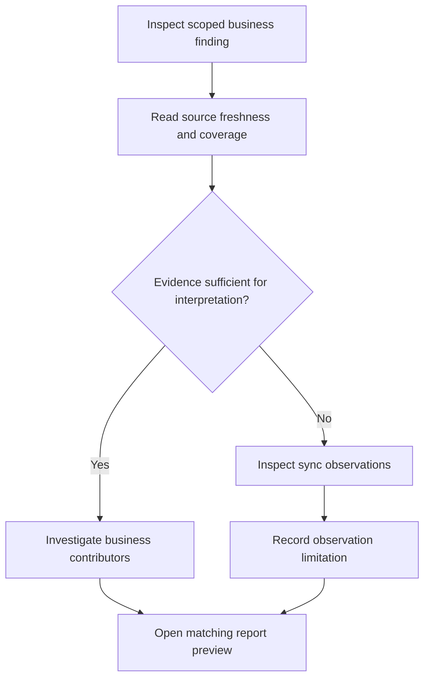

# Sarthak dashboard business workflows

**Owner:** Business Analyst Agent. **Reviewers:** Product Manager, Analytics, Security, UI/UX. **Status:** Proposed business analysis baseline. **Version:** 0.3. **Date:** 2026-10-14.

These workflows describe monitoring and investigation. CM, JDM, SDM, and Super Admin share the steps with different explicit assignments. Decisions to contact teams or correct source records happen outside the dashboard; notifications, approvals, and ticket creation are not implied.

## WF-01 Establish a review context

**Actors:** All four roles. **Trigger:** User opens a monitoring session. **Use case:** UC-01.

1. Establish the role and assigned monitoring scope, or choose a clearly labeled simulated role in the demonstration.
2. Select a reporting period and supported scope/scheme/course/batch filters.
3. Read the active scope, timezone, data cutoff, and relevant freshness/coverage notices.
4. Open a monitoring area and retain compatible filters across drilldown.

**Branches:** No assignments produces a no-assigned-scope state; an assigned scope with no matching records produces an empty state. A forbidden scope is denied when enforcement exists. Unsupported filter combinations are explained. A source failure shows unavailable, not zero.

**Outcome:** A visible, consistent context for subsequent review. **Criteria:** AC-C01–03, AC-C06.

## WF-02 Review center network and scheme coverage

**Actors:** CM for local centers; JDM for assigned districts/areas; SDM for assigned broader areas; Super Admin for overall monitoring. **Use cases:** UC-02–03.

1. Complete WF-01 and inspect total onboarded, active, inactive, and unknown centers.
2. Read the business classification rule and cutoff, then open a status-specific center list.
3. Group by scheme category and scheme and inspect distinct centers and unassigned mappings.
4. Drill into a contributing center, retaining scope and filters.
5. Check source freshness before deciding whether further operational investigation is justified.

**Branches:** A center may be active but stale/offline; unknown classification stays separate. Overlapping scheme memberships are disclosed, so summed group counts need not equal overall distinct centers. Missing history blocks historical classification or requires a current-state label.

**Outcome:** A center-network finding with traceable contributing records. **Stories:** CM-01–02, JDM-02, SDM-02–03, SA-01–02. All story references have the US prefix in [user stories](user-stories.md).

## WF-03 Review batch creation, capacity, and enrollment

**Actors:** All four roles within assignment. **Use case:** UC-04.

1. Inspect batches created per month under the agreed original creation date/timezone policy.
2. Select a month or batch subset and review eligible enrollments, unique learners, capacity, and utilization.
3. Inspect batch details to explain low utilization, missing capacity, or overcapacity.
4. Compare aggregate utilization using summed comparable seats/capacity; inspect exclusions and coverage.
5. Carry the finding to WF-07 if a report preview is needed.

**Branches:** Missing/zero capacity yields unavailable; late upload does not move creation into receipt month; cancelled/transferred enrollments follow the agreed policy. One learner in multiple batches remains distinct from the enrollment count.

**Outcome:** A reproducible capacity/enrollment finding, with denominator and time basis. **Stories:** CM-03, JDM-03, SDM-04, SA-03.

## WF-04 Investigate participation and learning outcomes

**Actors:** All four roles; learner-level details only if separately permitted. **Use cases:** UC-05–06.

1. Select authorized centers/batches and inspect attendance states and recording coverage.
2. If observations are stale or missing, check WF-05 before interpreting participation.
3. Inspect assessment eligibility, attempt selection, grading, and outcomes.
4. Review course completion against eligible assignments and its stated rule.
5. Inspect certification independently to identify completed-but-not-certified records or unsupported/unknown source statuses.
6. Compare equivalent populations and document a finding outside the application or through WF-07.

**Branches:** Unuploaded attendance is not absence; ungraded assessments are not failures; completed courses are not automatically certified. Zero denominators show unavailable. Restricted learner details remain unavailable to unauthorized roles.

**Outcome:** A participation/outcome finding that preserves source and eligibility limitations. **Stories:** CM-04–05, JDM-04, SDM-05, SA-04.

## WF-05 Investigate synchronization and observation coverage

**Actors:** All four roles at their assigned scope. **Use case:** UC-07.

1. Inspect connectivity observations, sync outcome, last successful synchronization, and source freshness independently.
2. Drill into an authorized center/device or synthetic scenario with stale, never-synced, partial, or failed observations.
3. Read receipt cutoff and known coverage; use a pending local-record count only if the source actually reports it.
4. Determine whether a business finding is supported, needs more evidence, or should be discussed with operational teams outside the dashboard.
5. In the demonstration, review the supplied later snapshot representing backlog receipt or retry and compare the expected changes.

**Branches:** A duplicate retry changes no learning totals. Late valid events revise the original business period under the agreed policy. A later successful receipt does not prove every device has uploaded all activity. Never synced has no invented last-success time.

**Outcome:** An explained synchronization exception and its impact on monitoring confidence. **Stories:** CM-06, JDM-05, SDM-06, SA-05. The user does not initiate sync or edit records here.

## WF-06 Compare district and regional performance

**Actors:** JDM for assigned districts; SDM for assigned regions/divisions; Super Admin for overall geography. CM may inspect geographic context only within permitted assignments. **Use cases:** UC-08–09.

1. Choose authorized geographic groups and equivalent reporting periods.
2. Compare the same defined center, capacity, participation, outcome, and synchronization indicators.
3. Check eligible populations, denominators, coverage, and mapping overlap/unassigned records.
4. Drill from region to district to center where mappings and permissions support the path.
5. Use WF-02–05 to investigate contributors and WF-07 to communicate the result.

**Branches:** Non-additive memberships must be labeled; raw learner counts do not substitute for comparable rates; historical comparisons require supported history. Unapproved composite scores and rankings are excluded.

**Outcome:** A defensible geographic comparison, with its limits. **Stories:** JDM-01–02/05, SDM-01–03/05, SA-06.

## WF-07 Prepare a scoped report preview

**Actors:** All four roles. **Use case:** UC-10.

1. Start from a monitoring view or select a supported report template.
2. Confirm role scope, filters, period, timezone, and snapshot cutoff.
3. Preview center-network, batch/learning, or geographic/synchronization findings.
4. Verify displayed totals match the dashboard under the same context; read freshness, coverage, generation time, and synthetic-data label.
5. Use a file-download action only if that optional format is implemented; otherwise the experience remains preview-only.

**Branches:** No data produces an explicit empty preview. A changed snapshot triggers a version/cutoff explanation before comparing totals. A denied scope or detail remains denied in reports. Report preparation failure shows an error and does not create a success claim.

**Outcome:** A consistent management preview, with no implied scheduled delivery. **Stories:** JDM-06, SDM-06, SA-06; available as shared reporting behavior to CM and all other stories under REQ-018.
