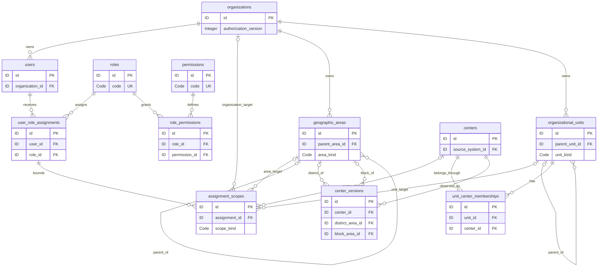
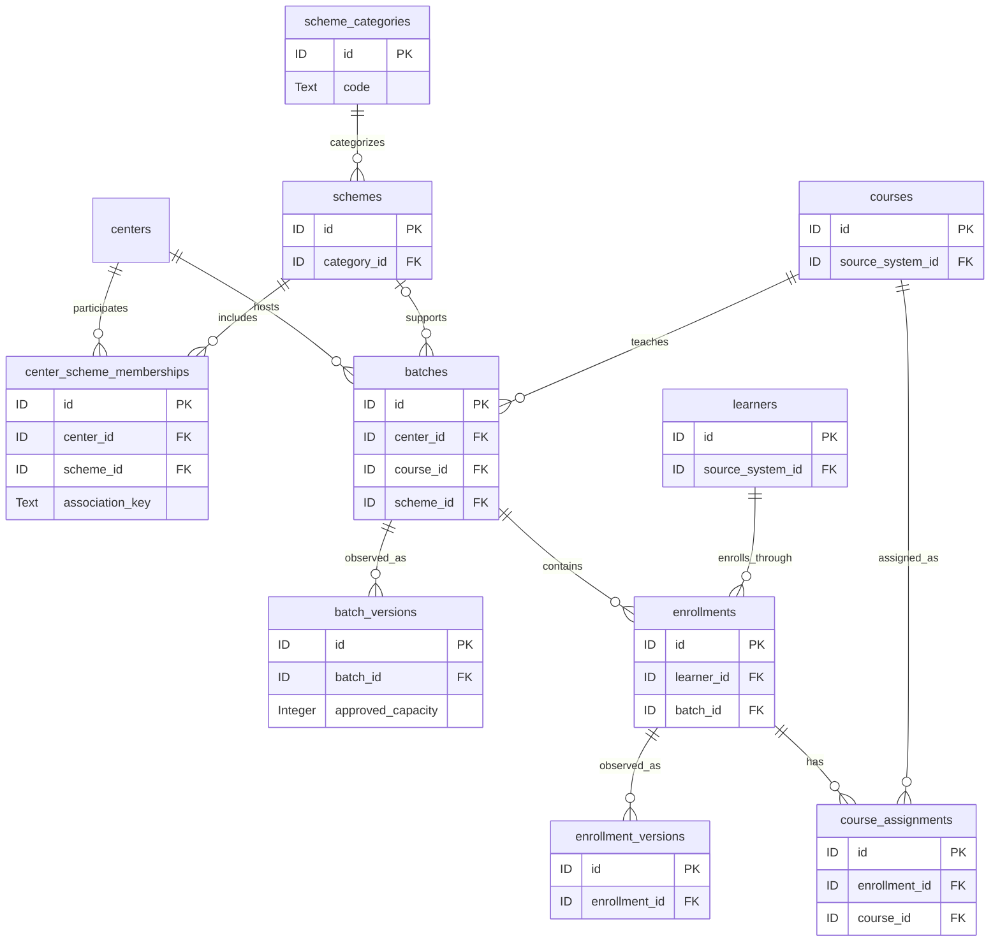
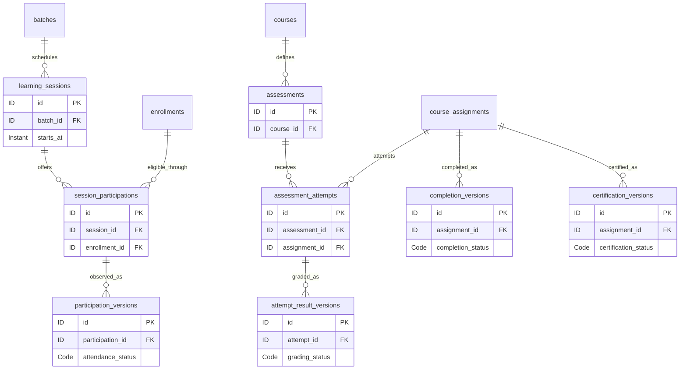
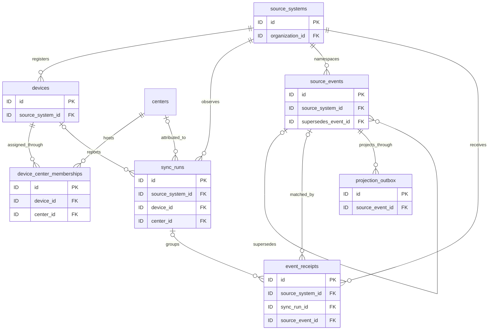
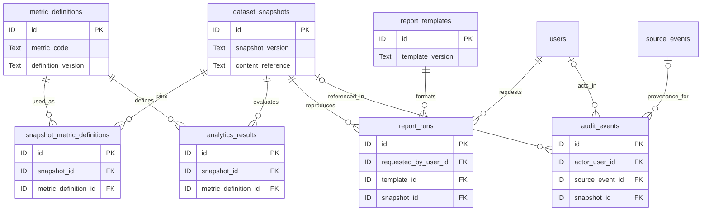

# Sarthak entity relationship model

**Owner:** Database Architect Agent. **Reviewers:** Solution Architect, Business Analyst, Analytics, Security, Backend, QA. **Status:** Proposed logical ER model. **Version:** 0.6. **Date:** 2026-10-14.

These diagrams split the 44-entity [schema](database-design.md) into readable domains. They are documentation, not executable schema. Each entity's complete fields, inherited organization ownership, provenance, and nullability are in [the dictionary](data-dictionary.md). Mermaid diagrams show representative key fields; omitted fields and repeated ownership/provenance arrows still apply.

`||` means exactly one, `o|` zero or one, and `o{` zero or many. Cardinality describes possible stored records, not permission inheritance or evidence that every source has uploaded complete data. All organization-owned relationships preserve organization equality. The proposed geographic tree, operational-unit mappings, and temporal membership constraints require A-01/A-02 approval.

## Users roles and center scope

Every assignment_scopes row populates exactly one matching target FK. The four optional target relationships are alternatives, not four simultaneously granted scopes. An organization target is explicit; an assignment without any scopes grants none. A district has a region parent and a proposed block has a district parent, while a root region has no parent. A-24 must approve block membership; a center's block parent must agree with its district when both are supplied. Cluster/division operational units have independent effective center memberships and do not automatically follow geography or represent blocks.

## Schemes batches and enrollments

Centers and schemes are many-to-many through versioned memberships. A batch's optional scheme link is not a substitute for validating its center's scheme membership. One learner can have many distinct enrollments across centers/batches; learner identity has no exclusive center owner. Authorization selects permitted enrollments first and then counts distinct learner IDs within that population.

One course per batch and one category per scheme are proposed baseline simplifications. Multiple-course batches or time-varying scheme taxonomy require approved mapping/version extensions. Full dimension copies are pinned in published snapshots so later labels or mapping changes do not alter earlier reports.

## Attendance assessments completion and certification

There is at most one stable session_participations identity for an enrollment/session pair, but multiple observation versions. The enrollment's batch must equal the session's batch. Roster-derived opportunities can exist before attendance observations; missing observations are unrecorded/unknown. No roster means unknown denominator coverage, not zero opportunities.

An attempt's assessment and assignment must have the same course. Attempt-selection and eligibility policies are separate from the existence of attempts. Completion and certification both reference the assignment; neither depends on the other's row. Certification is one status timeline per assignment in this proposed baseline; multiple concurrent credentials require a credential identity extension. Missing observations never imply failure, absence, or not-issued status.

## Source events and synchronization observations

Additional required source_systems relationships apply to centers, courses, batches, learners, enrollments, course_assignments, learning_sessions, assessments, and assessment_attempts. Every inherited version source_event_id is an optional provenance relationship. Version supersedes_id is an optional self-reference constrained to the same stable parent or association.

A run can have unresolved device/center mapping, but such telemetry cannot bypass role scope as a user-facing unowned record. Receipts may have no canonical event after validation rejection. Many identical receipts can map to one event revision. A correction is a new accepted source revision; same identity/revision with conflicting digest does not become a second canonical fact.

Outbox uniqueness and the canonical write share a commit boundary. Transfer success does not itself guarantee projection/publication success, freshness, or complete local activity coverage.

## Analytics reports and audit

Published content is an immutable materialized dataset/manifest, not a generic foreign key to whichever canonical records are current. Manifest validation proves its exact record versions and definition membership. An analytics result must use a definition pinned to its snapshot and the complete authorized context; an aggregate row is never an access grant.

Report templates and publications are pinned, but report access is checked against current permissions. Optional private artifacts inherit this access check. Audit targets use redacted evidence locators rather than arbitrary polymorphic FKs; removing a source record must not automatically erase audit evidence.

## Relationship and business-rule review

| Area | Business cardinality or invariant | Acceptance concern |
| --- | --- | --- |
| Roles/scopes | User-to-role is many-to-many through assignments; each assignment has zero or more explicit targets | No target means no data; role titles never establish geography |
| Geography | Proposed region-to-district-to-block-to-center path, with direct district fallback and optional unknown block | Unknown mapping remains visible; no inferred cluster/block equivalence or invented history |
| Operational units | Units and centers are many-to-many through effective memberships | Deduplicate center identity across overlapping grants |
| Schemes | Categories have schemes; centers have many scheme memberships | Group totals may be non-additive |
| Batches/enrollment | Center/course have batches; learners and batches connect through enrollments | Enrollment counts differ from distinct learners |
| Attendance | Enrollment/session opportunity is unique; observations are versioned | Missing is not absent; batch mismatch is invalid |
| Outcomes | Assignment has many attempt observations and independent completion/certification timelines | Grade pending is not fail; completion is not certificate evidence |
| Sync | Source event revision has many receipts and projection instructions | Retry delivery does not inflate accepted facts |
| Snapshots/reports | Publication pins definitions; report pins publication/template/context | Identical context yields reconcilable values |
| Audit | Optional actors and provenance, append-only event identity | Unknown actor is allowed; restricted evidence survives approved record lifecycle changes |

Conditional relationships, nonoverlap, same-course/batch checks, and snapshot manifest validation require explicit constraints or transactional validation in a later implementation. Diagram completeness does not prove source availability or deployed enforcement.
