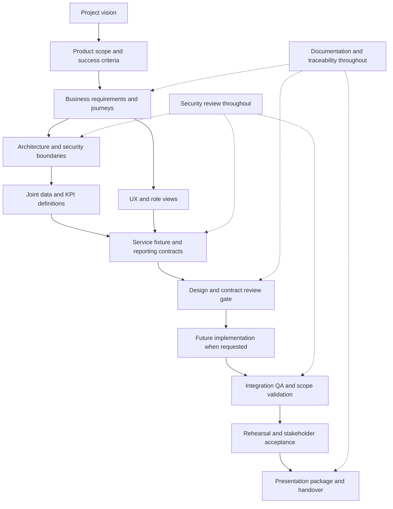

# Agent dependencies and project workflow

## Dependency matrix

An upstream input is required before the consuming deliverable can be baselined. Agents may explore drafts in parallel, but must not treat unresolved assumptions as accepted contracts.

| Agent | Required upstream inputs | Outputs consumed by | Required reviewers |
| --- | --- | --- | --- |
| Product Manager | User vision; BA discovery feedback | All agents | BA, QA |
| Business Analyst | Product scope and audience | Architect, UX, Database, Analytics, Reporting, Security, QA | PM, Security, Analytics |
| Solution Architect | Scope, business rules, security constraints, joint data/metric model | Backend, Frontend, Database, DevOps, QA | Security, Database, Backend, DevOps |
| UI/UX | Journeys, visibility rules, data availability, KPI definitions | Frontend, Reporting, QA, Documentation | PM, BA, Frontend, QA |
| Database Architect | Hierarchy, event boundaries, metric needs, classification | Backend, Frontend, Analytics, Reporting, QA | BA, Analytics, Architect, Security |
| Backend | Architecture, data model, KPIs, report behavior, access rules | Frontend, Reporting, QA, DevOps | Architect, Frontend, Security |
| Frontend | UX, contracts/fixtures, metrics, report actions, access rules | QA, Documentation, DevOps | UX, QA, Security |
| Analytics | Eligibility rules, data grain, timestamp semantics | Database, Backend, Frontend, Reporting, QA | BA, Database, QA |
| Reporting | Audience, KPIs, snapshot fields, access rules | Backend, Frontend, QA, Documentation | Analytics, Security, UX |
| Security | Personas, scope, trust boundaries, data classification | All design/delivery agents | Architect, BA, QA |
| QA | Requirements, states, scenarios, expected metrics, scope rules | Domain owners, PM, orchestrator | BA, PM, Security for security cases |
| DevOps | Implementation mode, runtime plan, audience, access constraints | Backend, Frontend, QA, Documentation | Architect, Security, QA |
| Documentation | Domain documents and review evidence from every agent | All agents and stakeholders | Domain owner, QA for evidence claims |

Database and Analytics jointly resolve grain, eligibility, and timestamps rather than waiting on each other serially. Architect and Security similarly co-review trust boundaries. Those collaborations produce a shared baseline before downstream contracts are frozen.

## Workflow diagram

The current delivery establishes the plan for this flow and stops before design execution or implementation.

## Handoff procedure

1. The producing agent records deliverable ID, owner, version, review state, input versions, linked requirements, acceptance criteria, and open issues.
2. Named reviewers check correctness and compatibility with their own deliverables. They record accept, revise, or blocked, with a reason.
3. The orchestrator resolves contradictory rules and identifies affected consumers. Business decisions go to Product Manager and the project stakeholder; architecture decisions go to Solution Architect with domain reviewers.
4. Documentation updates links and traceability. The receiving agent acknowledges the accepted version before freezing its own output.
5. QA checks coverage against acceptance conditions; the phase gate records evidence and outstanding issues.

## Work item states

Use Proposed, Ready, In progress, In review, Accepted, and Blocked. Ready requires available inputs and acceptance criteria. Accepted requires recorded reviews, and stakeholder acceptance where the phase plan calls for it. Blocked items record the missing input, responsible owner, and impact. None of the future work is Accepted merely because it appears in this planning package.

## Change control

Assign each scope change a change ID, rationale, owner, affected requirements, effort impact, and phase impact. PM prioritizes; Architect and affected domain agents assess compatibility; QA updates coverage; Documentation updates the accepted baseline. Scope changes that expand the user mandate require a new user instruction.

Changing eligibility, hierarchy, snapshot cutoff, or a freshness rule must notify Database, Analytics, Backend, Frontend, Reporting, Security where scope is affected, and QA. No agent silently forks a shared definition.

## Agent execution capacity

The team contains 13 specialist roles, not 13 simultaneous workers. Run ready tasks in batches within available concurrency capacity. During this planning session, all 13 roles contribute through specialized agent tasks. Future execution should prioritize scope and requirements, then joint design reviews, then dependent delivery tasks. Stop scheduling implementation after the planning completion gate in this assignment.
