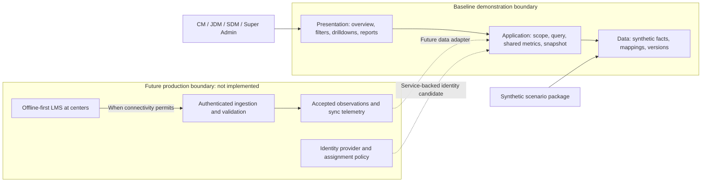
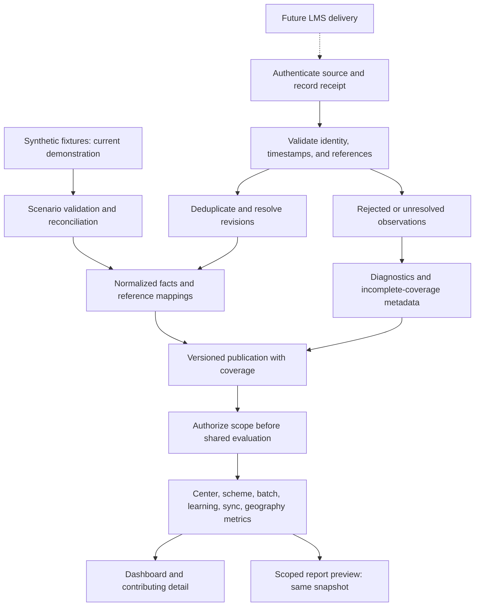
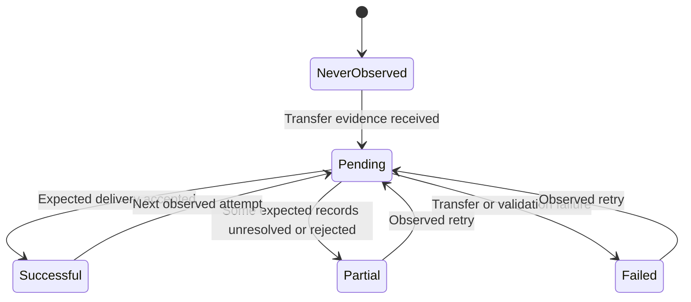
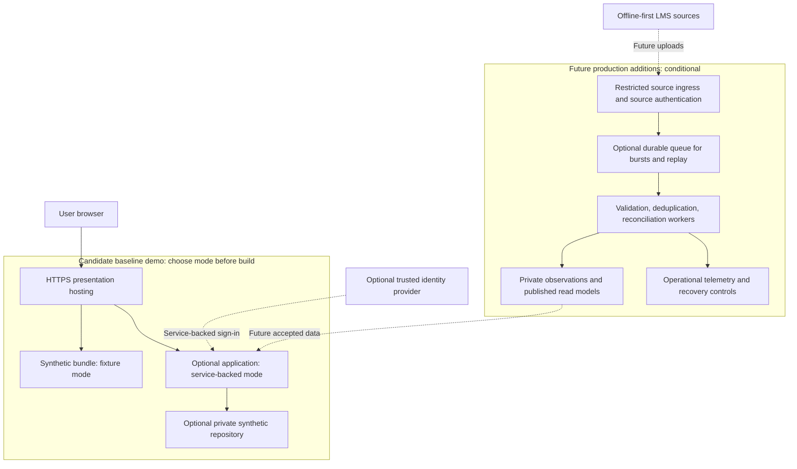

# Sarthak dashboard high-level design

**Owner:** Solution Architect Agent. **Reviewers:** Product Manager, Database Architect, Analytics, Security, DevOps, QA. **Status:** Proposed design; demonstration mode, hosting, and production integration unselected. **Version:** 0.4. **Date:** 2026-10-14.

## System context and high-level architecture

The dashboard turns cloud-observed LMS facts into scoped monitoring views and matching report previews. Offline LMS operation is independent of dashboard availability. Users inspect what the cloud knows, with visible coverage/freshness limits; absence of uploads is not proof of absence of learning.

The logical layers can be delivered together. There is no mandatory microservice topology, continuous LMS connection, stream processor, or separate analytics warehouse. A later ingestion adapter can preserve application contracts when real source evidence becomes available. Identity and LMS integration are different trust boundaries and must not share authority implicitly.

## Business data flow

The synthetic path validates a versioned scenario, normalizes its records and mappings, calculates expected totals, and publishes a snapshot. The user resolves scope, chooses filters, reads metrics, drills into contributing records, and previews reports under the same context. No scenario change claims a real synchronization operation.

The future source path receives authenticated deliveries, establishes source identity, records receipt, validates record quality, deduplicates retries, resolves references and corrections, then publishes accepted facts. Rejected or unresolved records have visible diagnostic/coverage consequences but do not count as learning achievements. Dashboards need not block on every source; their publication describes accepted coverage and omitted observations.

Center totals use distinct eligible centers, with active/inactive/unknown classifications independent of sync. Scheme groups use valid memberships and disclose non-additivity. Batch creation uses occurrence month, utilization uses summed eligible seats over comparable capacity, and enrollments remain distinct from unique learners. Attendance missingness is not absence; assessment grading, completion, and certificate issuance remain separate facts. Geographic rates recompute from eligible numerators/denominators, not averages of center percentages. These rules trace to REQ-003–017; policy details remain open in A-03–13.

## Synchronization monitoring architecture

The dashboard observes synchronization; it does not synchronize the LMS. A future adapter supplies transfer-attempt identity, source/device or center mapping, observed start/end, transfer outcome, accepted/rejected counts if available, and trustworthy success evidence. Pending local counts are shown only when reported by the source with observation time and coverage. The cloud cannot infer all unuploaded records.

Maintain independent dimensions: observed connectivity, transfer outcome, source coverage, source-data age, and cloud processing/publication progress. A successful transfer can carry old business events; fresh publication can still contain incomplete source coverage. Center summaries may aggregate multiple devices only under an approved rule and disclose mixed outcomes. A single successful device cannot silently make a whole center fully synchronized.

This is a candidate transfer-outcome model, not a definition of source connectivity. Never observed and never successfully synced differ. Pending is shown only with evidence; a missing heartbeat does not prove a queued transfer. Stale is a separate age/coverage classification under A-17, so a last-successful outcome may also be stale. Cancellation, expiry, or reconciliation states require source evidence before addition.

Future receipt handling associates each event with a stable source namespace and event identity. Identical retry content produces no additional learning fact. Repeated identity with changed content is a correction/conflict candidate, not an unconditional overwrite. Referential gaps and suspect timestamps remain unresolved with a reason. A receipt acknowledgement means delivery accepted at the receipt boundary; successful validation/publication is separately observable. Retry behavior must not depend on pretending these milestones are equivalent.

Future concurrent processing requires an atomic deduplication boundary: reserve or verify source/event identity in a dedup ledger and commit its canonical fact/revision together, so two workers cannot both count one delivery. A ledger entry alone must not mark a fact successfully applied before that write commits. If projection/publication work is separate, commit a durable processing/outbox record with the canonical write, then deliver it idempotently using the committed revision identity. Retrying after a crash must either observe the completed canonical write or safely apply it once; publication cannot increment totals merely because a message was delivered again. The storage mechanism and transactional guarantees remain decisions for the future source implementation.

Partial batches publish only accepted facts with coverage, or remain unpublished as a whole if the agreed consistency policy requires it. That choice is open; either model must avoid marking rejected records as completed learning activity. A late valid batch-creation event updates its original month in a new snapshot. An existing report remains identified with its old publication; a regenerated report clearly uses the newer one. QA should compare normal, duplicate, late, failed, mixed-device, and partial scenarios under REQ-015/022.

## Cloud deployment architecture

No cloud vendor, runtime, region, network product, database, or hosting destination is selected (DEC-011). The simplest candidate demonstration deploys a static presentation and synthetic bundle. If selected, service-backed mode adds one application boundary and a private repository; it need not introduce independent services per domain. Access audience, credential handling, and exposure are reviewed before deployment.

Future ingress is separated from user-facing monitoring and restricted through approved network/application controls, source authentication, payload limits, and validation. A dedicated firewall product is not mandated. Queueing is useful if bursts, retry tolerance, or replay requirements justify it; a direct durable receipt path may suffice at lower volume. Neither a queue nor receipt persistence replaces validation and idempotency.

Future application and data boundaries should limit public access to intended entry points; repositories and credentials are inaccessible to the browser. Transport, identity integration, secret storage, access audit, backup, restoration, and operational alerting are production design work rather than delivered controls. A demonstration hosting diagram does not claim redundancy or a recovery service level.

## Scalability and resilience strategy

Start by measuring representative scope sizes, dataset growth, concurrent review sessions, drilldown cardinality, report complexity, sync bursts, and correction frequency. No capacity numbers or SLOs are approved. Establish query/report latency, ingestion-to-publication lag, availability, and recovery objectives with Product/DevOps before sizing a production deployment.

Keep query contracts stable while improving internals. Page bounded drilldowns, select only necessary fields, reuse versioned metrics, and cache scope-safe snapshot results. If evidence warrants it, index frequent filter/grouping dimensions and maintain additive read models with validated grain. Distinct learner/center counts and overlapping schemes require appropriate identity-aware aggregation; summing precomputed distinct counts is not generally valid.

For sustained ingestion or expensive recalculation, separate receipt from processing using durable backlog handling and bounded workers. Track backlog age, rejected/unresolved counts, publication lag, query errors, and coverage rather than relying on an HTTP success alone. Recompute affected event-time periods when accepted late facts change history, and atomically publish a new version. Larger read traffic may justify additional application instances and scoped caching; analytics isolation or partitioning follows measured workload and approved boundaries.

If a worker fails after receipt, retry from durable accepted input with stable event identity. If publication fails, keep the preceding coherent version and disclose staleness. If identity/authorization is unavailable, deny enforced requests rather than assume scope. If a source is unavailable, preserve known observations with coverage warnings. Future backups and restore drills must recover mappings, definition versions, identities, and lineage together; recovery targets remain open.

## Reviewable outcomes

Architecture review should confirm that all monitoring domains reach the shared scope/snapshot path, every simulated/future boundary is labeled, and source writes remain excluded. QA criteria include dashboard/detail/report reconciliation, duplicate invariance, late-arrival revision, mixed sync outcomes, unavailable denominators, permission-denial paths if built, and coherent publication after failure. No deployment or verification is claimed by this documentation.
