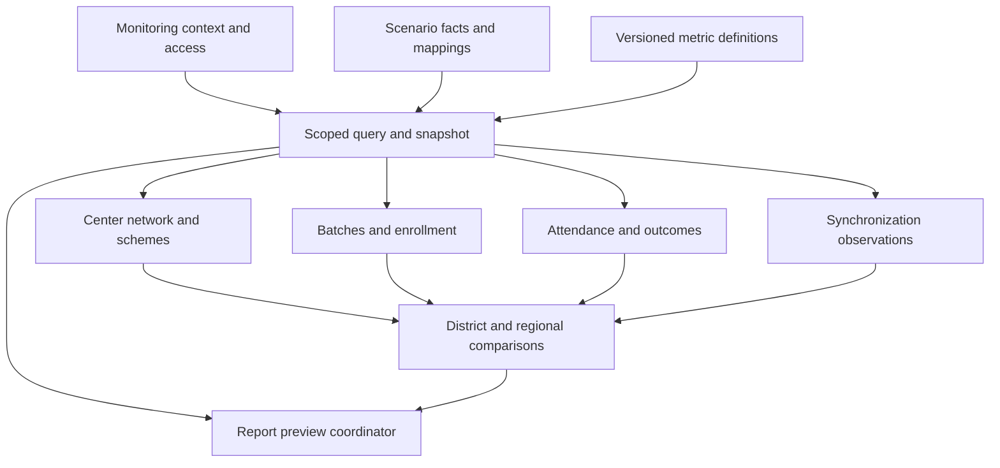

# Sarthak dashboard module breakdown

**Owner:** Solution Architect Agent. **Reviewers:** Business Analyst, Frontend, Backend, Database Architect, Analytics, Reporting, Security, QA. **Status:** Proposed logical module baseline; contracts and permissions pending approval. **Version:** 0.4. **Date:** 2026-10-14.

## Module boundaries and dependencies

Modules describe coherent monitoring responsibilities; they do not mandate services, routes, code packages, or storage technologies. All business modules depend on resolved scope, compatible filters, a pinned snapshot, and shared metric definitions from [system architecture](system-architecture.md). None independently invents role permissions, resets filters on drilldown, or reads a different publication silently.

Geographic comparisons reuse eligible populations and metric definitions, not unscoped visual totals supplied by another page. Report previews use the same query/evaluator contracts; the diagram is conceptual reuse, not a requirement to call one screen from another.

## Module responsibilities and acceptance handoffs

| Module | Inputs and logical outputs | Rules and exceptions | Requirement/use-case trace |
| --- | --- | --- | --- |
| M-01 Monitoring context and access | Subject or labeled scenario role, assignments, capabilities, filters → effective scope and visible context | Explicit no-scope/denied states; incompatible filters explained; four roles supported; server enforcement only when selected | REQ-001–002; UC-01 |
| M-02 Center network | Center identities, onboarding/status history, cutoff → onboarded/active/inactive/unknown counts and lists | Distinct centers; same eligibility for count/detail; sync never substitutes for activity; missing history disclosed | REQ-003–005; UC-02 |
| M-03 Scheme coverage | Taxonomy and valid center memberships → category/scheme distribution and contributing centers | Center once per distinct group; cross-group overlap labeled; unmapped/unassigned bucket; no assumed additive totals | REQ-006–007; UC-03 |
| M-04 Batch monitoring | Batch creation, capacity history, eligible enrollment → monthly creation, capacity, seats, utilization, detail | Occurrence month; missing/zero capacity unavailable; comparable populations for numerator/denominator; overcapacity visible | REQ-008–009; UC-04 |
| M-05 Enrollment monitoring | Enrollment identities/status, learner mapping, batch/course context → eligible enrollments and distinct learners | Retakes/transfers/cancellations follow policy; distinct learners cannot be derived by summing batch-level distinct totals | REQ-010; UC-04 |
| M-06 Attendance | Eligible learner-session opportunities and source observations → present/absent/unrecorded, rate and coverage | Missing is not absent; cancelled sessions and eligibility require A-09; identity detail optional and permission checked | REQ-011; UC-05 |
| M-07 Assessment | Assessment eligibility, attempt/grade facts, selection rule → attempted, graded, pending, pass/fail measures | Attempt versus learner counts explicit; ungraded not failed; pass denominator and retake policy versioned | REQ-012; UC-06 |
| M-08 Completion | Eligible course assignments, completion evidence/history → completed/eligible and completion rate | Learner population is not the assignment denominator; absent evidence unknown; corrections remain traceable | REQ-013; UC-06 |
| M-09 Certification | Separate certification source evidence, eligibility, status → supported status distribution and rate | No certificate inferred from completion; unsupported vocabulary unknown/source-limited; no issuance action | REQ-014; UC-06 |
| M-10 Sync monitoring | Source/device mappings, attempts, receipts, published observations → outcomes, last success, age, coverage | Never observed/successful, pending, partial, failed, and stale dimensions distinguished; local backlog unknown unless reported | REQ-015; UC-07 |
| M-11 Geographic analytics | Approved center/district/region mappings and shared eligible facts → district/regional comparisons and drilldowns | Scoped population first; aggregate rates weighted by underlying denominator; overlap/unmapped disclosed; no composite score | REQ-016–017; UC-08–09 |
| M-12 Reporting | Approved template, context, definitions, snapshot → matching scoped preview and metadata | Preview baseline; download optional; access rechecked; generation time differs from receipt cutoff | REQ-018; UC-10 |
| M-13 Scenario and quality | Versioned synthetic facts, expected totals, provenance → validated publication and repeatable reset narrative | Fixed reference date and synthetic labels; invalid scenario cannot silently replace current snapshot | REQ-019, REQ-021–022; all cases |
| M-14 Presentation states and accessibility | Module results and view state → keyboard-usable tables/charts, state labels, context continuity | Loading, empty, error, partial, stale, unknown, and denied differentiated; responsive/accessibility target pending | REQ-019–020; all cases |

## Role-specific composition

CM emphasizes M-02–10 for assigned centers, with authorized report previews. JDM adds permitted district comparison through M-11; SDM emphasizes permitted regional comparison and contributing districts. Super Admin's proposed platform-wide monitoring combines all modules and mapping/coverage exceptions. These are navigation priorities from [personas](user-personas.md), not approved privilege inheritance. Geographic views for CM/JDM and individual learner fields for every role remain governed by explicit capabilities.

## Delivery responsibilities

BA approves definitions and the permission matrix with Product/Security. Database Architect supplies grains, stable identities, mappings, history availability, and scenario lineage. Analytics owns the versioned formulas and expected aggregation behavior. Backend owns trusted context, contracts, publication and failure handling if a service mode is chosen. Frontend/UI/UX owns context continuity, readable rendering, explanations, and simulation labels. Reporting owns template metadata and parity with dashboard results. DevOps owns proposed hosting and repeatable delivery after mode selection; QA owns reconciliation, exception, accessibility, and enforced negative-access validation.

Delivery order is definitions/scopes → scenario grains and metrics → shared context/publication contracts → core center/scheme/batch/learning views → synchronization and geographic comparisons → report parity and demonstration rehearsal. Modules may be specified in parallel, but dependent implementation cannot freeze unresolved definitions. Future live ingestion has a separate readiness gate for source authentication, deduplication, corrections, coverage, and operations.

## Contract review and completion evidence

Each module specification must state grain, allowed filters, date basis, cutoff, source/history availability, denominator/exclusions, role actions, detail fields, missing/error states, and version metadata. Screens, fixture scenarios, report sections, and planned validation cases trace back to the requirement IDs above; detailed field/API contracts are later deliverables, not implied implementation here.

Review examples include a center in two schemes, a learner in two batches, a missing-capacity batch, unrecorded attendance, an ungraded assessment, completion without a certificate, duplicate retry, late creation, unmapped geography, mixed device outcomes, denied direct detail, and a report pinned before publication changes. [Acceptance criteria](acceptance-criteria.md) defines required behavior; these architecture documents do not claim the tests have run.
