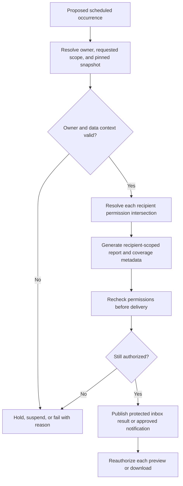

# Sarthak reporting strategy

**Owner:** Reporting Agent. **Reviewers:** Business Analyst, Product Manager, Analytics, Security, Database Architect, Solution Architect, UI/UX, QA, DevOps. **Status:** Proposed reporting specification; formats and automation policies awaiting approval. **Version:** 0.7. **Date:** 2026-10-14.

## Purpose and delivery boundary

Define the eight required reports for centralized monitoring of the Sarthak Offline-First LMS, including filters, drilldowns, export formats, and scheduled reporting. Reports describe cloud-observed records and their limitations. All metrics reuse [metric definitions](metric-definitions.md) and [the KPI catalogue](analytics-kpis.md); permissions follow [system architecture](system-architecture.md).

This phase produces documentation only. Report previews remain the proposed MVP baseline; executable exports are optional until scoped. Scheduled generation and delivery are documented future capabilities under this request, extending the earlier [reporting planning brief](reporting/reporting-plan.md) without implementing automation or changing the [MVP](mvp-scope.md) to require a scheduler. No report files, jobs, emails, cloud resources, or external schedules are created.

## Roles and authorized report populations

| Role | Proposed reporting emphasis | Scope constraint |
| --- | --- | --- |
| CM — Cluster Manager | Assigned-center performance, status, batches, learning, and synchronization | Explicit assigned centers/clusters; a cluster is not automatically a block/district |
| JDM — Junior Divisional Manager | Assigned district comparisons and contributing centers | Explicit assignments, with separate comparison/detail rights |
| SDM — Senior Divisional Manager | Assigned regional/divisional comparisons and district contributors | Division/region equivalence and broader permissions are not assumed |
| Super Admin | Platform monitoring, scheme/geography comparisons, and source coverage | Broad monitoring remains subject to approved actions, learner-detail, and export permissions |

All four roles may preview permitted reports; the table describes emphasis, not automatic entitlement. Apply current authorization before filters, aggregates, pagination, report generation, delivery, and access. A report ID or stored artifact never confers permission. Geography comparisons restricted to a user's assigned centers must say “assigned scope within selected area,” rather than implying complete district/regional coverage.

## Common report contract

Every preview, export, and scheduled result identifies report ID/name, template version, organization and effective role/scope, validated filters, business date interval/cohort, stock evaluation cutoff, reporting timezone, snapshot/version and receipt cutoff, metric-definition versions, generation time, row/population counts, exclusions, source freshness/coverage, and synthetic-data status. Generation time is not data-as-of time.

Use the same snapshot, eligible population, filters, and metric rules as the corresponding dashboard. Date intervals are [start, end); stock measures separately state their as-of cutoff. Received late events can revise original business periods in a new publication. Retained reports are immutable evidence of their original snapshot; reissued reports have a new run/version and link to the earlier result.

Zero, unavailable, unrecorded, and unknown remain different. Zero denominator is N/A. Missing attendance is not absence, pending grades are not failures, course completion is not certification, and offline/stale synchronization is not an inactive-center classification. Exact integer counts and one-decimal percentages follow the metric policy; parent rates use aggregated numerators/denominators, never averages of percentages.

## Filter definitions

| Filter | Meaning and validation |
| --- | --- |
| Organization/role scope | Set by trusted assignment or labeled demo context; client filters cannot widen it |
| Region, district, block, center | Intersect authorized centers with approved mapping at the selected cutoff; block is conditional on A-24; unknown mapping is disclosed |
| Operational unit | Optional cluster/division assignment filter; uses independent unit memberships, not inferred geography |
| Scheme category and scheme | Compatible taxonomy/membership selection; scheme outcomes use batch attribution, while center coverage uses memberships |
| Business period | Event window for session/activity/batch creation, or explicitly labeled assignment cohort for completion/certification |
| As-of cutoff | State evaluation point for status, capacity, enrollment, certification, and health; unsupported history is labeled/unavailable |
| Course/batch | Applies to learning/capacity sections only; center-network or device-only sections must declare if it is unsupported |
| Center activity | Recorded active/inactive/unknown policy; locked to active or inactive in the corresponding status report |
| Batch lifecycle | Approved planned/running/completed/cancelled vocabulary; utilization retains its defined comparable population |
| Learning status | Optional attendance/grading/completion/certification detail filters; does not silently redefine summary denominators |
| Sync outcome/freshness/health | Separate transfer outcome, source age, and target health classifications; unknown is selectable and never hidden by default |
| Selected comparison areas | Explicit permitted region/district IDs; identical metric/cohort policies across selections |
| Snapshot | Pinned publication for dashboard/report parity; not an access credential |

Unsupported combinations are rejected or explained; a section must never appear to apply a filter it ignores. A learner-status detail filter may narrow a table while the KPI denominator stays the selected eligible cohort; both scopes must be labeled. Scheme comparisons distinguish center membership, batch attribution, and associated-center sync populations.

## Required report catalogue

### RPT-001 Center Performance Report

**Purpose:** Review learning, capacity, and operational conditions at authorized centers. **Audience:** All four roles within assigned scope. **Grain:** One center summary row, with separate batch/session/outcome details.

**Content:** Center identity/geography, onboarding/activity classification, scheme memberships, monthly batches, eligible enrollments and distinct learners, comparable seats/capacity and utilization, attendance/recording coverage, engagement, assessment/grading outcomes, eligible course completion, certification statuses/rate, and target sync health/freshness. Show numerator/denominator and exclusions for rates. Assessment results require an approved attempt-selection policy.

**Filters:** Authorized geography/center/unit, scheme/category, reporting period, assignment cohort, as-of cutoff, course/batch for applicable learning sections, activity status, snapshot. A scheme filter selects center membership for network coverage and matching batch scheme for learning, with distinct population labels.

**Drilldowns:** Center → batches → eligible enrollment aggregates; batch → session attendance or assignment assessment/completion/certification; center → sync targets/runs. Individual learner/certificate identifiers require separate permission. Preserve context and snapshot on every path.

**Formats:** Preview; proposed PDF, XLSX, and CSV summary/details. **Cadence:** Proposed weekly, with optional monthly review. **Trace:** REQ-003–015, REQ-018; KPI-01–08. **Acceptance:** Center rows and detail populations reconcile; missing observations remain visible; center status and sync health remain independent.

### RPT-002 Active Center Report

**Purpose:** List centers classified active under the recorded business rule. **Audience:** All four roles within assignment. **Grain:** One distinct active center at cutoff.

**Content:** Center code/name, geography, applicable schemes, onboarding milestone, activity rule/version, known batch/enrollment context, last observed sync and coverage. Header includes selected-scope onboarded/active/inactive/unknown counts before the locked active detail selection, clearly separated from the active-only list count.

**Filters:** Geography/center/unit, scheme/category, as-of cutoff, snapshot; activity status is locked active. Any supporting learning period is separately labeled. No historical active classification is inferred from today's state.

**Drilldowns:** Active center → RPT-001 under that center/snapshot; sync exception → RPT-006. **Formats:** Preview; proposed PDF/XLSX/CSV. **Cadence:** Proposed weekly; optional daily review.

**Trace/acceptance:** REQ-003–004, REQ-018; KPI-01. Active detail count equals distinct listed centers. A stale/offline active center remains on the list; unknown classification is disclosed but not included as active.

### RPT-003 Inactive Center Report

**Purpose:** List known inactive centers for investigation. **Audience:** All four roles within assignment. **Grain:** One distinct inactive center at cutoff.

**Content:** Center identity/geography, onboarding/status evidence, classification rule/version, source-provided inactivity reason if available, scheme coverage, and sync/freshness notices. Do not invent causes from missing uploads. Show scope-level unknown classification alongside the inactive list count.

**Filters:** Geography/center/unit, scheme/category, as-of cutoff, snapshot; activity status is locked inactive. **Drilldowns:** Center → RPT-001; source observation → RPT-006; permitted geography → comparison reports.

**Formats:** Preview; proposed PDF/XLSX/CSV. **Cadence:** Proposed weekly. **Trace:** REQ-003, REQ-005, REQ-018; KPI-02. **Acceptance:** Inactive detail count agrees with the classification population; unknown centers are not computed as inactive by subtraction from total minus active.

### RPT-004 Scheme Performance Report

**Purpose:** Compare coverage and learning/capacity outcomes by scheme category and scheme. **Audience:** All four roles within assignment. **Grain:** Distinct center coverage per scheme plus separately attributed batch/learning results.

**Content:** Category/scheme, distinct participating centers and activity split, batch creation, eligible enrollments/distinct learners, utilization, attendance/coverage, engagement, assessment outcomes, completion/certification, and associated-center sync observations.

**Attribution:** Center coverage uses valid center_scheme_memberships. Batch and learning outcomes use batches.scheme_id and its enrollment/assignment facts, not every scheme attached to that center. Null batch scheme is unassigned. A center in two schemes can appear in both coverage rows; its unrelated learning facts are not duplicated into both. Associated-center synchronization is explicitly center-based, not scheme-specific transfer success. Group totals are not presumed additive.

**Filters:** Scheme category/scheme, geography/center/unit, event period, assignment cohort, as-of cutoff, applicable course/batch, snapshot. **Drilldowns:** Category → schemes → participating centers; scheme → attributed batches → learning/capacity details; associated centers → sync report.

**Formats:** Preview; proposed PDF summary, XLSX with separate coverage/outcome sheets, CSV datasets with declared grain. **Cadence:** Proposed monthly. **Trace:** REQ-006–014, REQ-018; applicable KPI-01–08. **Acceptance:** Membership coverage and batch attribution are visibly distinct; overall distinct centers/learners are recomputed rather than summed across overlapping schemes.

### RPT-005 Batch Creation Report

**Purpose:** Show original monthly batch formation, with authorized batch details. **Audience:** All four roles within assignment. **Grain:** One canonical batch and original business creation month.

**Content:** Monthly distinct creation count, source creation time, center/geography, course, attributed scheme, batch lifecycle/capacity and eligible enrollment where supported, missing-date/exclusion counts, and late-receipt/revision notice. Creation trend is a flow; capacity/status values separately state their as-of cutoff or current-state limitation.

**Filters:** Creation interval/calendar month, geography/center/unit, scheme/category, course, lifecycle policy, snapshot; stock detail cutoff is separate. Cancellation/deletion inclusion follows the approved creation-count rule and is shown.

**Drilldowns:** Month → distinct batches → center/course/enrollment/capacity detail. **Formats:** Preview; proposed PDF chart/summary, XLSX monthly/detail sheets, CSV batch-level records. **Cadence:** Proposed monthly; optional weekly current-month provisional review.

**Trace/acceptance:** REQ-008–010, REQ-018. January creation received in February stays in January. Repeated event delivery adds no batch; missing creation timestamp is an excluded unknown, not assigned to receipt month.

### RPT-006 Synchronization Report

**Purpose:** Explain transfer observations and their impact on data confidence. **Audience:** All four roles within assignment. **Grain:** Separate expected-target summary and transfer-run detail datasets.

**Content:** Expected target roster/coverage, healthy/degraded/unknown counts and KPI-08, center/device mapping, trustworthy last successful sync, connectivity observation, most recent transfer outcome, pending/partial/failed/stale notices, source-reported expectations/backlog if known, accepted/rejected/conflicting receipt counts, and processing/publication coverage. No local pending count is invented. Detailed diagnostic fields remain sanitized and permission-controlled.

**Filters:** Geography/center/unit, source/device, observed transfer period, evaluation cutoff, outcome, freshness/health category, snapshot; scheme filter only selects associated centers and states that meaning.

**Drilldowns:** Area → center → expected targets → runs → permitted sanitized receipts/conflicts and publication evidence. **Formats:** Preview; proposed PDF exception summary, XLSX target/run sheets, separate CSV target/run datasets. **Cadence:** Proposed daily; optional weekly summary.

**Trace/acceptance:** REQ-015, REQ-018; KPI-08. Target-weighted health is not run success rate; transfer success does not prove complete local data or freshness. Duplicate retries appear in receipt history without inflating learning measures. Never observed differs from proven never-successful history.

### RPT-007 District Comparison

**Purpose:** Compare equivalent indicators across authorized districts. **Audience:** Primarily JDM, SDM, Super Admin; CM only if permitted. **Grain:** District within explicit assigned population, with underlying source-grain aggregation.

**Content:** District coverage, center activity, scheme distribution, monthly batches, weighted utilization, enrollments/distinct learners, attendance/coverage, engagement, assessment outcomes, course completion, certification, and sync health. Show raw counts, rate denominators, exclusions, and unknown mappings. No unapproved composite score or ranking.

**Filters:** Permitted district set, region, optional mapped block, scheme/category, course where supported, shared event period/cohort, as-of cutoff, snapshot. Label partial district coverage if assignments include only some centers.

**Drilldowns:** District → approved blocks or direct centers → RPT-001; scheme/batch/sync findings → RPT-004–006. Unknown blocks stay disclosed in district totals. **Formats:** Preview; proposed PDF comparison, XLSX numerator/denominator and detail sheets, CSV district metrics with coverage columns. **Cadence:** Proposed monthly; optional weekly operational comparison.

**Trace/acceptance:** REQ-016, REQ-018; KPI-01–08. Equal definitions/cohorts/cutoffs are required; percentage averages and misleading comparisons caused by missing coverage are excluded.

### RPT-008 Region Comparison

**Purpose:** Review authorized regional differences and district contributors. **Audience:** Primarily SDM and Super Admin; JDM/CM only where permitted. **Grain:** Region within assigned population.

**Content:** Same indicator set and metadata as District Comparison, with region populations, contributing districts, and mapping/coverage limitations. Distinct learners are deduplicated at region scope; rates are recomputed from comparable source facts.

**Filters:** Permitted regions, compatible district/block/center scope, scheme/category, shared period/cohort/cutoff, applicable course, snapshot. **Drilldowns:** Region → RPT-007 for its permitted districts → blocks/centers → relevant domain detail. Region and district reports compare the same publication, not independently fetched latest data.

**Formats:** Preview; proposed PDF executive comparison, XLSX region/district/metric-detail sheets, CSV region metrics. **Cadence:** Proposed monthly. **Trace/acceptance:** REQ-017–018; KPI-01–08. Additive center totals reconcile where mappings are exclusive; overlapping assignments, unmapped areas, and partial permitted coverage remain visible.

## Export strategy

| Format | Proposed purpose | Metadata and integrity rules |
| --- | --- | --- |
| On-screen preview | Core stakeholder walkthrough and drilldown | Full context, coverage and definition references; no implied download |
| PDF | Presentation-friendly summaries/charts and selected tables | Scope/period/cutoff and page context; readable legends; explicit omitted-detail notice; never silently truncate |
| XLSX | Comparison and analysis with summary/detail sheets | Metadata sheet; separate dataset grains; stored results agree with preview; no hidden restricted sheets or external links |
| CSV | Interoperable flat-grain datasets | UTF-8, stable headers, unambiguous dates/timezone and null handling; metadata columns plus companion metadata document, including for empty datasets |

All eight reports have candidate PDF/XLSX/CSV formats; the exact executable capability matrix remains an implementation scope decision. Unsupported actions are absent or labeled preview-only. Static exported documents cannot provide interactive dashboard drilldowns; they may include clearly labeled navigation references subject to authorization, not embedded access grants.

CSV dates use explicit instant offsets or declared business dates; unavailable rates are blank with a reason column, never zero. CSV text and XLSX strings require an approved inert-text handling policy for formula-like source values; they must not become executable spreadsheet formulas. Security reviews this behavior while preserving useful source labels. No macros or active imported content are proposed.

Export the full authorized filtered dataset within agreed limits, not just the current UI page. Sort/order, row limits, file sizes, timeouts, and asynchronous thresholds remain open. If a limit is reached, clearly mark partial coverage or reject/split the export with documented scope; the report cannot imply completeness. A multi-file package repeats context and snapshot identifiers for every dataset.

Store any future artifact privately, with authenticated access and separately approved expiry/retention. Recheck current permissions before generation and download; include only permitted fields. A revoked grant prevents future artifact access. Previously downloaded files cannot be recalled, so data minimization precedes export. Learner-level and certificate identifiers are not included by default.

## Scheduled reporting specification

Scheduled reporting is a proposed future feature, not an active automation or MVP implementation commitment. The cadence examples below require stakeholder approval, a chosen reporting timezone, available snapshots, recipient authorization, and operational limits. They must not be interpreted as configured jobs.

### Proposed cadence and period rules

| Report | Candidate recurrence | Business context | Proposed readiness/delivery convention |
| --- | --- | --- | --- |
| RPT-001 Center Performance | Weekly, Monday 09:00 | Prior complete Monday-to-Monday week; stock measures evaluated at explicit period-end cutoff | Use a selected published snapshot available before generation; show coverage; optional monthly cohort review |
| RPT-002 Active Center | Weekly, Monday 09:00 | Status stock at the agreed weekly cutoff | Classification policy/history required; no status inferred from week activity |
| RPT-003 Inactive Center | Weekly, Monday 09:00 | Same weekly status cutoff as active report | Keep unknown population separate; use matching snapshot for reconciliation |
| RPT-004 Scheme Performance | Monthly, second calendar day 10:00 | Prior calendar month; explicit assignment cohort and outcome cutoff | Shared monthly snapshot freeze proposed at 09:00 on generation day |
| RPT-005 Batch Creation | Monthly, second calendar day 10:15 | Original batch creations during prior month | Same monthly snapshot freeze; label late/missing evidence and stock-detail cutoff |
| RPT-006 Synchronization | Daily, 09:00 | Prior day's transfer window plus explicit target-health evaluation cutoff | Source cadence/expectation policy required; health can use current evaluation time, clearly distinct from prior-day run interval |
| RPT-007 District Comparison | Monthly, second calendar day 11:00 | Prior calendar month; identical cohorts/stock cutoff across districts | Same monthly snapshot freeze as other comparison reports |
| RPT-008 Region Comparison | Monthly, second calendar day 12:00 | Same period/cohorts/cutoff as district report | Same pinned monthly snapshot; recompute from shared facts, not district export files |

Times are examples in the eventual approved reporting timezone, not inferred from the workspace timezone. A cadence does not impose a production SLA. A freeze pins one coherent published dataset; it does not guarantee all offline sources have uploaded. Snapshot selection, permitted age, grace/wait period, stale-data delivery versus hold, and lateness/reissue rules require approval. If no usable snapshot exists, the occurrence is held/failed with a reason rather than sending an empty successful report.

Recurring periods are derived from calendar boundaries, not a fixed number of hours. Timezone changes and ambiguous/missing clock times must have an approved policy and an occurrence identifier so a retry cannot create a second scheduled occurrence. Monthly flow windows and stock/cohort evaluation points are separately persisted. Data arriving after a freeze changes a later/reissued report, not the original artifact.

### Schedule definition

A future schedule records organization, owner principal, report/template version, requested scope expression, filters, recurrence, timezone, business-period rule, stock cutoff/cohort rule, snapshot-selection policy, formats, registered recipients, channel, enabled state, effective dates, retention/expiry, and retry/misfire policy. Recipients cannot be arbitrary email addresses that bypass the approved user/access model.

The current schema has report_templates and report_runs but no schedule/delivery entities. Future implementation would require reviewed schedule, occurrence, recipient, and delivery-attempt records with stable identities, versioned configuration, authorization evidence, and links to report_runs. This phase describes those responsibilities without creating tables, migrations, scheduler infrastructure, or delivery accounts.

### Authorization and execution workflow

1. Validate the owner's current report-preview/export/schedule capability, requested scope, chosen format, and registered recipient set. These capabilities remain proposed permissions, not automatic role grants.
2. At the occurrence, resolve business context and pin a compatible snapshot/template/metric set. Check owner status and assignments again; a disabled owner or invalid scope suspends/fails the occurrence.
3. Resolve each recipient's current permitted actions/fields/center set. Generate each recipient's result from the intersection of requested scope, owner's current scope, and recipient's current scope. Do not send a broad owner's artifact to a narrower recipient or filter a computed global total after generation.
4. Persist the run/occurrence context and permission evidence. Preview/report generation obeys the same metric/coverage contract as manual reporting.
5. Immediately before delivery, recheck owner and recipient permissions; changes invalidate generation or require safe regeneration. Prefer an authenticated in-app report inbox and optional metadata-only notification with an authenticated access path. Raw learner/report attachments and public bearer links are not the baseline proposal.
6. At every subsequent preview/download, check current permissions again. Mark delivered/failed/expired according to actual channel evidence; notification acceptance is not proof that a recipient read the report.

In fixture-only mode, schedules may be represented by labeled mock configuration/history. Such a demonstration must not claim enforced recipient security or a running scheduler. No actual external communication is authorized by this documentation request.

### Reliability and lifecycle

Proposed schedule states are Draft, Active, Paused, Suspended, and Retired; runs/attempts have separate queued/running/ready/failed/expired and delivery outcomes. Creating a schedule does not mean generation or delivery succeeded. Owner/configuration changes create audited versions; retired schedules create no new occurrences.

Use a stable occurrence key containing schedule version and intended period/trigger. Retry an occurrence without creating duplicate report/delivery intents. After an uncertain delivery response, reconcile using provider evidence where available; do not promise exactly-once external delivery. Retry policy is bounded, and persistent failure records sanitized causes and prompts authorized operational review.

Define whether missed occurrences are skipped, replayed once, or generated as explicitly delayed results; never flood recipients with implicit catch-up. Permission/configuration changes during retry force reauthorization. Limits on recipients, concurrent runs, backlog, generation size, and runtime require capacity review. Cadence, timezone, failed/held occurrences, artifact expiry, and recipients are visible in the future schedule history.

## Audit data and operational ownership

Use report_runs to link requester, template, snapshot, context, permission version, output kind, timestamps, status, and optional protected artifact. Audit preview/export/access as required by the policy, schedule creation/change/pause/retirement, occurrence decisions, recipient scope checks, generation, notification/delivery attempt results, failure, expiry, and reissue. Evidence excludes raw personal report content, secrets, and unnecessary recipient contact information.

Reporting owns catalogue/template/metadata semantics; Analytics owns calculation versions; BA/PM validates business audience/cadence; Security approves access/recipient/export rules; Database defines future schedule/delivery persistence; Backend/Frontend owns eventual generation/experience; DevOps reviews operational limits and channels; QA validates parity and exceptional paths. No retention period, delivery service, provider, format capability, or service-level target is selected by this specification.

## Acceptance criteria

- All eight named reports have clear grain/content, supported filters, scoped drilldowns, candidate formats, and proposed cadence.
- Preview and optional exports match dashboard results for identical scope, definitions, period, and snapshot; different recipient scopes are labeled rather than presented as identical populations.
- Active/inactive classifications reconcile with unknown centers separately; scheme learning attribution avoids membership multiplication; monthly creation uses original business time.
- Percentages expose numerator/denominator, exclusions, and coverage. District/region comparisons preserve equivalent definitions and avoid averages of percentages or unapproved scores.
- Empty, unavailable, partial/stale, unknown, denied, failed, and oversized-output states are distinct. Export limits and omitted details are visible.
- Scheduled reporting examples remain proposals; future validation covers owner/recipient revocation, mismatched scopes, snapshot freeze, late reissue, timezone boundaries, missed occurrences, retries, uncertain delivery, and expiry.
- All formats preserve metadata and authorization; learner detail is separately permitted; direct artifact access cannot bypass current scope checks.

## Decisions required before implementation

Approve concrete report fields/layouts; complete role/report/detail/export/schedule permissions; choose executable formats and limits; validate block mappings and source/KPI policies; agree schedule ownership, recipients, timezone, recurrence, freeze/grace/misfire/retry/reissue policy; choose inbox/notification channels and operational retention. Record these decisions in [assumptions](assumptions.md) and [governance](governance/registers.md). This phase ends with the reporting strategy document and navigation updates; no reporting behavior has been implemented or tested.
