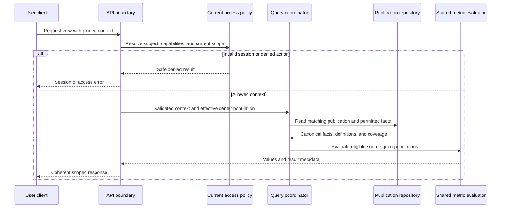
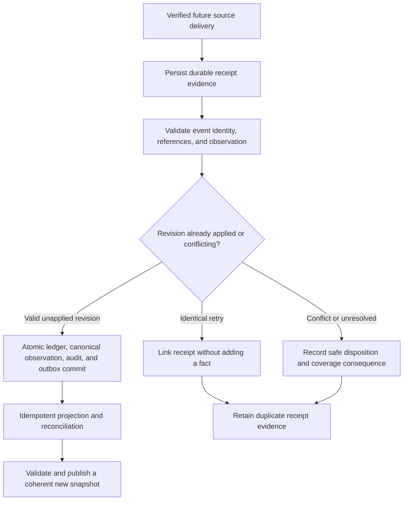

# Sarthak backend service design

**Owner:** Backend Agent. **Reviewers:** Solution Architect, Database Architect, Security, Business Analyst, Analytics, Reporting, Frontend, DevOps, QA. **Status:** Proposed logical service design; no runtime or technology selected. **Version:** 0.9. **Date:** 2026-10-14.

## Purpose and deployment boundary

Define how the 44 contracts in [API specification](api-specification.md) support the monitoring experience. Responsibilities below can live in one modular application; they do not require separately deployed services, a selected framework, a message broker, or a cloud provider. The [architecture](system-architecture.md), [database design](database-design.md), and [metric definitions](metric-definitions.md) remain the sources for scope, grains, and calculation meaning.

Fixture-only demonstration can reproduce contract semantics with synthetic scenarios without actual network endpoints/authentication. A service-backed synthetic prototype can later exercise trusted access and shared query/publication behavior. User administration/preferences, downloadable reports, scheduling, and actual source ingress are conditional extensions, not deployed features or unconditional MVP work.

## Service responsibilities

| Logical service | API ownership | Responsibility and data boundary |
| --- | --- | --- |
| Identity/session | AUTH-01–05 | Candidate identity handoff, correlated callback, trusted principal, session lifecycle; no local password collection or role assertion from browser |
| Access context/policy | Every user API | Current assignments, capability/field checks, organization and effective center population; scope first, then query/cache/report |
| Directory/access administration | USER-01–06 | Permitted metadata, verified principal linkage, versioned role/scope changes and revocation; separate identity-provider administration |
| Personal preferences | USER-07–08 | Own supported presentation settings; cannot change metric/report calendars or permissions |
| Center/reference query | CENTER-01–04, AN-01 | Canonical center/status/geography/unit/scheme membership with approved intervals; no operational center writes |
| Batch/learning query | BATCH-01–06 | Source batch formation/capacity, enrollment identity, attendance opportunities, assessment selection, assignment outcomes/certification |
| Shared metric evaluator | AN-02–03 and report/domain summaries | Pinned metric policies, source-grain eligible populations, ratios/coverage and geography rollups; no screen-specific formulas |
| Publication repository | AN-04 and all monitoring reads | Validated immutable content/manifest, definition set, lineage, receipt cutoff and coherent snapshot selection |
| Report generation/access | REPORT-01–05 | Approved template, exact query context, durable generation status, ready preview/optional private artifact, repeated access checks |
| Scheduling/delivery coordination | REPORT-06–10 | Future configuration/occurrence versions, current owner/recipient intersections, generation and sanitized channel evidence |
| Synchronization projection/query | SYNC-01–05 | Distinct target health, transfer outcome, connectivity, age and publication evidence; never a sync command service |
| Future source admission/processing | SYNC-06–07 | Independent source identity, durable receipts, event/revision validation, atomic dedup/canonical/outbox commit and publication |
| Audit/diagnostics | Cross-cutting | Correlation, security/material-change evidence, safe errors/operational metrics; no secrets or raw learner payloads in logs |

Services share contracts through defined boundaries. Geographic comparisons recompute source-grain numerators/denominators; they do not sum another page's unscoped totals. Report generation uses the same evaluator as the dashboard.

## Request processing and coherent query path

1. Resolve configured feature availability and trusted identity type. Dashboard session and source admission use distinct entry boundaries; neither can impersonate the other.
2. Validate coarse request shape/size and permitted action without leaking target existence. Resolve current principal state, policy version, and exact organization-owned scope. Explicit forbidden identifiers receive safe denial, not silent broad fallback.
3. Normalize supported filters, dates/cohort/as_of, metric/group choice, and pagination. Validate geographic kinds, block mapping availability, scheme attribution, and source/history/policy compatibility.
4. Pin the selected published snapshot and its metric definitions. Current authorization is not copied from that historical snapshot; it is checked now against the data population requested.
5. Obtain eligible canonical records within authorized scope, then evaluate, group, sort/page, or render permitted fields. Cache lookup is after permission/context resolution.
6. Return data plus applicable context, definition/cutoff/coverage metadata and request correlation. A newer publication is offered explicitly; it cannot replace only some panels or a report silently.

A protected-object 404 is used for both nonexistent and inaccessible detail. An unavailable policy/denominator produces explicit null/unavailable evidence or a validation error according to the API contract; an unavailable dependency produces a service error. Neither is represented as successful zero data. Lists with no assignments contain no organization-wide values.

## Identity access and concurrency

The candidate service-backed profile uses an approved external identity flow and a server-managed protected session. Issuer/subject linkage, transaction state, session renewal/absolute expiry, and revocation require Security/Backend review. Credentials/provider tokens remain in approved secure operational storage, not browser response bodies or the analytics database. Cookie security, same-origin/CSRF handling, callback profile, and identity-service failure behavior are deployment/profile decisions before implementation.

The proposed browser session uses Secure and HttpOnly cookie attributes, with a SameSite profile compatible with the approved callback and explicit CSRF/origin protection for unsafe application requests. Cookie scope, name, lifetime, rotation and cross-origin deployment must be reviewed together; frontend storage is not a substitute for trusted session validation. The application does not collect an LMS/offline-user password through these APIs.

Capability resolution combines allowed action, explicit current assignment, organization/center membership, effective interval, and permitted fields. User role names are not an organizational tree. An administrator seeing a user's scoped directory metadata does not gain control over that principal's unseen assignments or global enabled state.

The [security RBAC specification](security-rbac.md) binds each action to the scopes of assignments whose roles grant that action. Do not union every scope on a multi-role subject and apply its most powerful capability to the union. Current role grants, field permissions, service profiles and session targets remain proposed policies requiring acceptance before enforcement claims.

Use opaque version preconditions for administrative resources/preferences/schedules. Missing If-Match yields a precondition-required error; stale versions fail without overwriting. Role/scope changes validate every affected item and commit assignment updates, authorization version, and required audit/invalidation evidence together. Do not partially apply a multi-change request or allow empty scope to mean global. User self-elevation, privileged changes, and preservation of management authority remain A-27 policies.

Permission-version checks precede returning internal cached results, report content, or replayed write responses. Current scope change invalidates bound cursors and affected cache/artifact access. An internal cache key includes organization, effective scope/membership and action/field policy versions, subject where needed, normalized filters/date/cohort, metric/group, snapshot, timezone, and definition versions. Public/shared HTTP caching of private data is not proposed.

Idempotency records bind principal/namespace, endpoint, key, canonical request digest and operation outcome. Repeated identical authorized requests do not duplicate user records, grants, runs, schedules, or receipts; changed content under a key is conflict. Replay cannot expose a broader result after revocation. Retention and concurrency locking of these records require engine/runtime review.

## Report generation and scheduling lifecycle

REPORT-02 records a generation request durably before returning 202. The run holds requester, template/version, context, snapshot, definitions, format, and permission evidence. A future worker reauthorizes before reading and producing the preview/artifact; a changed scope cannot silently regenerate a broad original request under new authority. Invalid/expired context fails or requires a clearly labeled new request.

Only verified completed content makes a run ready. REPORT-04 exposes safe status; REPORT-05 rechecks current content scope/fields and artifact integrity/expiry. Artifacts are private and cannot be accessed using a public bearer URL. Candidate exports preserve all metadata, stated limits, and inert spreadsheet text. An oversized/partial artifact says so; ready generation is not notification delivered or recipient read.

Scheduling starts as a draft resource. Activation validates approved recurrence, timezone, business-period rule, snapshot freeze/wait policy, formats, registered recipients and channels. A stable occurrence identity prevents duplicate generation intents after retries/misfires. A future scheduler uses owner/requested/recipient scope intersections before source-grain calculation, never after generating a broader aggregate.

Owner and recipient permissions are rechecked at generation, delivery and later access. Paused/suspended/retired schedule state is separate from run and delivery state. Bounded retry/uncertain delivery reconciliation, missed-occurrence policy, late-data reissue, configuration version changes, and retention follow [reporting strategy](reporting-strategy.md). No real scheduler, notification provider, inbox, file export, or delivery is created now.

## Future source admission and retry-safe processing

LMS sources report data when connectivity permits. Admission maps a verified source principal to an enabled namespace and approved centers/event families. Dashboard cookies and Super Admin roles do not authorize source submissions. Source payload cannot set organization ownership, role grants, arbitrary tables, or trusted state.

Telemetry observation revisions can be represented as source events plus an observed sync-run projection; a revised projection preserves receipt/revision evidence and snapshot copies. It does not require mutable telemetry to stand in for an immutable business fact. Source namespace, source_run_key, observation_revision and event revision rules must be agreed before SYNC-06 can be implemented.

For SYNC-07, validate each delivery's stable source/event/revision identity, type-specific observation, same-source references, timestamp policy, and optional correction lineage. Compare a server-verified canonical digest. Identical retries link new receipt evidence to the existing event revision; differing content at the same identity is conflict. Supersession is same-source/business-event lineage with approved revision ordering, not lexicographic comparison of arbitrary revision strings.

| Proposed event family | Required business reference and observation contract |
| --- | --- |
| Center lifecycle/mapping | Stable center key; supported onboarding/activity/geography observation, business validity and classification provenance |
| Scheme membership | Stable association, center and scheme references, effective interval/status; no inferred duplicate center |
| Batch/capacity | Stable batch/center/course and optional scheme references; original creation evidence, lifecycle and capacity validity |
| Enrollment/assignment | Stable learner, batch, enrollment and course-assignment references; lifecycle/eligibility and business dates |
| Session/attendance | Session/batch and enrollment references; eligible opportunity, present/absent/unrecorded evidence and observation date |
| Assessment result | Assessment/assignment/attempt identity, attempted/grading dates, scale/outcome under the approved rule |
| Completion/certification | Assignment identity; independent completion or source-supported certification observation, eligibility and dates |
| Transfer observation | Registered run/device/center mapping, observed outcome/times, source-reported expectations with explicit count grain |

These families map to dictionary entities; exact per-family source field schemas, maximum payloads, and admission profiles remain a separate source-contract approval gate. No raw source JSON schema or ingestion implementation is generated by this phase.

Durable receipt is distinct from canonical application and publication; 202 never conflates them. Structural request/idempotency-key conflicts produce a request error; admitted per-record rejects/conflicts can be acknowledged as durable dispositions under a declared partial-delivery policy. If durable receipt cannot be guaranteed, return failure rather than accepted status.

The dedup ledger transition to applied, canonical fact/revision, required audit evidence, and projection instruction share one commit boundary. Concurrent workers cannot both apply one revision. If external projection/publication is separate, consume the committed outbox idempotently and use exact canonical identities rather than incrementing totals for every message. Worker failure retries safe committed input; publication failure leaves the previous coherent version.

Business occurrence, receipt, processing, last successful transfer, and publication times remain distinct. Clock/referral conflicts are quarantined or resolved by approved policy. Late valid events affect their original business period in a new snapshot; old report content stays pinned. Source expected local backlog is unknown unless explicitly reported; fresh receipt or successful transfer does not prove complete offline activity.

## Persistence and schema follow-up

The 44-entity [dictionary](data-dictionary.md) covers monitoring facts, provenance, publication, roles, report templates/runs, and audit. This API design additionally requires reviewed session/transaction storage, idempotency records, resource versioning for user edits, personal preferences, schedule/configuration/occurrence/recipient/delivery state, and source telemetry revision projections if those optional features are built. Their physical schema, retention, and engine guarantees are not silently supplied by the existing design.

Snapshots store validated immutable content/manifest with exact record and definition membership. Do not use a mutable pointer to latest facts for historical reports. Current authorization versions remain outside historical metric entitlement; archived data never restores an old grant.

## Audit observability and failure boundaries

Record safe request correlation, authorization outcomes, material administrative changes, durable generation/occurrence decisions, optional delivery/access evidence, source conflict/rejection, projection outcomes and snapshot publication. Avoid passwords, codes, tokens, complete identity assertions, raw imported payloads, and unnecessary learner/report content. Required change/audit persistence and access invalidation are part of privileged transaction design; fail closed when mandatory evidence cannot be guaranteed under the approved policy.

Observe query/report latency, error/rejection rates, receipt-to-application/publication lag, backlog age, duplicate/conflict counts, and source coverage. Targets, concurrency, page/payload/export limits, retries, retention, disaster recovery and notification dependencies remain open. Log/diagnostic visibility is itself scoped and capability-controlled.

## Review and contract validation plan

Before implementation, verify all 44 endpoints have request/response/validation/authorization definitions; read paths preserve snapshot/context; all four roles deny forbidden direct identifiers; static routes cannot collide with resource IDs; and cursors/cache/replay respect revocation. Validate invalid dates/fields, zero/unknown denominators, overlap, missing history, unmapped block, pending grade, independent certificate, and consistent dashboard/report calculations.

For conditional features, review stale If-Match, concurrent grants, missing audit commit, repeated writes, forbidden recipient intersections, expired artifacts, uncertain delivery, concurrent source retries, conflicting revision, partial admission, outbox replay and publication failure. Sessions/cookies/CSRF/provider validation require Security review of the approved profile. These are proposed future contract checks, not tests executed against a running service.
