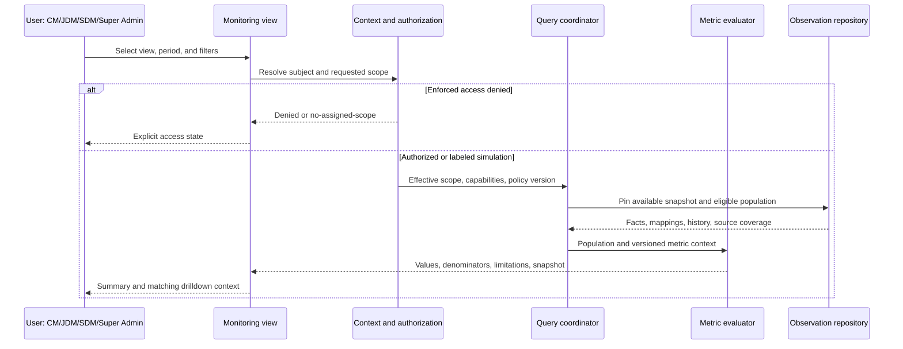
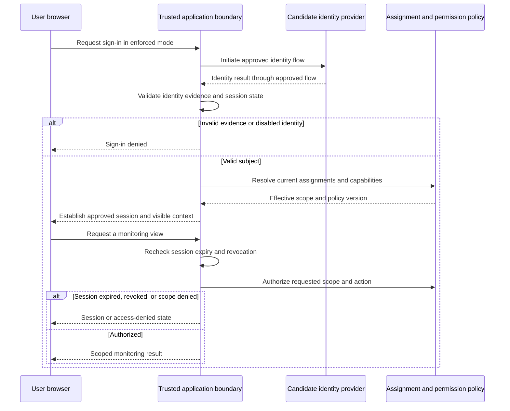
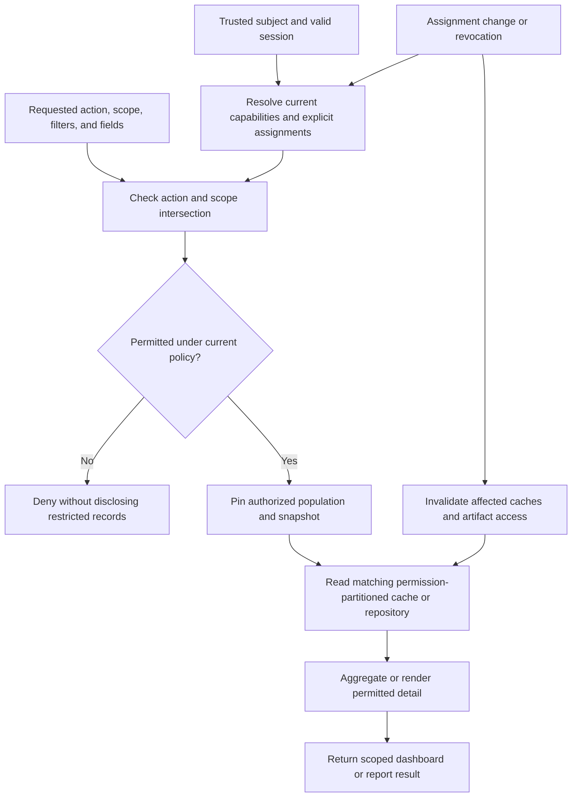

# Sarthak dashboard system architecture

**Owner:** Solution Architect Agent. **Reviewers:** Database Architect, Backend, Frontend, Analytics, Reporting, Security, DevOps, QA. **Status:** Proposed architecture baseline; implementation mode and policies open. **Version:** 0.4. **Date:** 2026-10-14.

## Purpose and boundaries

Sarthak is an Offline-First LMS; the dashboard is its proposed centralized cloud monitoring and analytics platform. This design supports the presentation prototype described in [product requirements](product-requirements.md) and [use cases](use-cases.md). It defines logical behavior, not implemented services, approved technologies, or production readiness. Synthetic scenarios remain the demonstration input. Offline learning, attendance entry, assessment delivery, certificate issuance, source correction, and execution of synchronization remain outside the dashboard boundary.

The proposed design has presentation, application, and data responsibilities that can coexist in one application. A future ingestion boundary supplies observations from actual LMS systems. Choosing fixtures versus a service-backed demonstration remains DEC-005; choosing simulated role selection versus sign-in remains DEC-009 in [the governance register](governance/registers.md). Neither a hosted page nor hidden navigation establishes access enforcement.

See [high-level design](high-level-design.md) for context/deployment diagrams, [module breakdown](module-breakdown.md) for requirements coverage, and [technical decisions](technical-decisions.md) for proposed ADRs. This package extends the [architecture planning brief](architecture/architecture-plan.md); business assumptions remain governed by [A-01–23](assumptions.md).

## Architecture coverage map

| Requested area | Primary location |
| --- | --- |
| High-level architecture | High-level design: system context and high-level architecture |
| Low-level architecture | This document: logical components, contracts, query interaction, and publication integrity |
| System components | This document: low-level logical components |
| Module breakdown | Module breakdown: responsibilities, dependencies, and requirement traceability |
| Data flow | High-level design: business data flow; this document: query interaction |
| Synchronization monitoring | High-level design: synchronization monitoring architecture; this document: publication integrity |
| Authentication | This document: authentication architecture |
| RBAC | This document: RBAC and scope architecture |
| Scalability | High-level design: scalability and resilience strategy |
| Cloud deployment | High-level design: cloud deployment architecture |

## Low-level logical components

| Component | Responsibility and handoff | Failure boundary |
| --- | --- | --- |
| Monitoring shell | Maintains visible scope, filters, view, period, and selected snapshot; renders charts with table alternatives | A view error does not erase context; loading and empty are distinct |
| Context resolver | Resolves authenticated or labeled simulated subject, capabilities, assignments, and policy version | No assignments produces an explicit no-scope state; unresolved identity is denied in enforced mode |
| Authorization policy | Intersects assignments with requested filters and checks action/detail permissions before reading data | Unauthorized identifiers and aggregate requests are denied without disclosing records |
| Query coordinator | Validates supported filter combinations, pins snapshot, routes metric/detail requests, and assembles coverage metadata | Unsupported history or filters are explained; it never substitutes a different cutoff silently |
| Metric evaluator | Applies versioned eligibility, date, denominator, grouping, and missing-value rules | Unavailable rates retain their reason; unknown values are not converted to zero |
| Observation repository | Supplies normalized synthetic facts or future accepted observations, reference mappings, and available history | Missing history is declared; invalid observations cannot enter published totals |
| Sync projector | Converts transfer observations into outcome, last-success, source coverage, and freshness views | Transfer failure remains separate from center activity classification |
| Snapshot/report coordinator | Pins publication and definition versions, renders scoped previews from the same evaluator | Unavailable snapshot fails explicitly; optional downloads require separate capability approval |
| Scenario publisher | Validates fixtures, expected totals, lineage, and scenario version before atomic publication | Invalid fixture sets retain the preceding validated snapshot |
| Audit/diagnostic boundary | Records authorization outcomes, query correlation, scenario publication, and future ingestion errors | Logs exclude unnecessary learner identifiers, secrets, and raw imported payloads |

These are responsibility boundaries, not required independently deployed services. A small coherent prototype can reuse one evaluator and repository across modules. Domain-specific storage and API decisions follow mode selection rather than being implied by this table.

## Logical contracts and query interaction

A monitoring request carries the requested view/action, compatible filters, period/cohort meaning, as-of cutoff, and selected snapshot. In enforced mode the application obtains identity and assignment versions from trusted server context; client-supplied role or scope is a request, never proof of permission. The resolver supplies effective authorized center membership and permitted fields to downstream readers.

A metric result carries value or unavailable reason, units, grain, numerator/denominator where relevant, eligibility/exclusions, timezone, coverage, definition version, snapshot identifier, receipt cutoff, publication time, and source limitation. Detail results identify the contributing population under that same context. Filter choices are themselves scoped: exposing a center name in an option list is a data disclosure.

A report request references a supported template and pinned monitoring context. Its result retains role/scope description, filters, period, timezone, snapshot and definition versions, generation time, coverage, and synthetic-data label. It does not acquire permission by possessing a snapshot identifier. Every preview or future download is authorized on access; expired permissions override previously generated access.

Requests return coherent publication versions even when a newer scenario is available. Failed retrieval produces an error; a previously loaded snapshot may remain visible with its age and error notice. Partial module availability is identified rather than showing a fully successful overall refresh. Drilldown/report comparisons require the same snapshot, scope, definitions, and filters (REQ-018, REQ-019, REQ-022).

## Authentication architecture

The fixture demonstration may use a clearly labeled role/scenario selector. It contains synthetic data and presents role narratives without claiming identity verification, secure sessions, or negative authorization enforcement. A public fixture bundle cannot protect records already delivered to the browser. The hosting audience and demonstration disclosure still need review.

For a service-backed candidate, a trusted identity provider using an approved identity protocol such as OpenID Connect is proposed, not selected. A trusted application boundary validates issuer, intended recipient, validity, and session state before resolving assignments. Authentication proves the subject; application policy establishes allowed actions and scope. Provider roles alone do not invent organizational membership. Sign-in failure, expired session, invalid identity evidence, and disabled identity result in explicit denied/session states rather than fall-through to a demo identity.

The candidate session lifecycle is sign-in, trusted subject resolution, assignment/policy lookup, request authorization, expiry or revocation, and sign-out. Client role selection cannot elevate an authenticated subject. The mechanism for session storage, expiry, revocation, and provider availability remains a Security/Backend decision. User provisioning, role administration, and policy editing are outside MVP monitoring use cases. Security review follows the [security planning brief](security/security-plan.md).

This sequence describes a service-backed candidate only. The browser redirect/callback mechanism, identity protocol profile, session storage, and expiry policy require separate review; it is not an implemented sign-in flow. Fixture mode uses the labeled demonstration selector instead.

## RBAC and scope architecture

Use role capabilities plus explicit scope assignments; deny by default in enforced mode. No title implies a CM→JDM→SDM organizational chain or a district/division equivalence. A-01/A-02 require approved membership, overlap, delegation, effective dates, and current-versus-historical access rules before permission contracts are frozen.

| Role | Proposed monitoring emphasis | Scope constraint and permission questions |
| --- | --- | --- |
| CM | Assigned center operations, batches, learning, and sync exceptions | Assigned centers/clusters only; district/regional comparisons require explicit permission |
| JDM | Assigned district/operational comparisons and contributing centers | Explicit assignments; access to all districts or particular CMs is not assumed |
| SDM | Assigned regional/divisional trends and district drilldowns | Explicit assignments; a division is not presumed a region or global scope |
| Super Admin | Platform-wide monitoring and systemic coverage review | Proposed broad monitoring only; learner detail, exports, account changes, and infrastructure privileges are separate capabilities |

The conceptual actions are view overview, compare geography, drill into center/batch, view permitted detail, preview report, and optionally download report. All four roles may monitor their authorized population; comparison and learner-detail permissions require approval. Source writes, sync commands, certificate issuance, and administration are excluded.

Apply scope before aggregation, grouping, pagination, chart generation, report creation, and optional export. Shared cross-scope totals cannot be filtered after calculation to produce a safe scoped view. Detail identifiers, direct links, filter options, sync logs, report artifacts, and historical snapshots receive equivalent checks. Responses must not disclose whether forbidden records exist.

Candidate cache identity includes effective scope or membership fingerprint, action/detail policy, assignment/policy version, normalized filters, period/cutoff, scenario/publication version, metric-definition version, and timezone. User-specific restricted fields require subject separation or a proven equivalent permission partition. Permission changes invalidate affected caches/artifacts; sign-out clears client-held sensitive views in an enforced implementation. Authentication failures cannot reuse another user's cached response.

Authorize each request against current effective permissions before returning cached data or report content. A cache hit or prior report generation does not bypass revocation. A queued optional report job rechecks permissions before generation and again before access; changed assignments invalidate or prevent access to results that exceed the current scope. Already downloaded files cannot be recalled by session revocation, so permission and data-minimization checks precede any optional export.

These are conceptual enforcement boundaries. They do not grant learner-detail rights, create an administrative workflow, or claim that fixture data delivered to a browser is protected.

## Data and publication integrity

Logical source grains include center lifecycle, valid scheme membership, batch with capacity history, enrollment, eligible learner-session attendance, assessment attempt/grade, course assignment/completion, independent certification status, and source/device transfer observation. Stable source identities support joins without substituting display names. Availability of history is explicit; no invented historical center status or capacity is allowed (A-19).

Publish a coherent set of facts, reference mappings, metric definitions, and provenance under one snapshot version. Updating a scenario or accepting late observations creates a new publication; readers retain the old version until explicitly refreshed. Reports describe what was received and processed by their cutoff, rather than claiming complete occurrence-time knowledge.

Retain business occurrence, cloud receipt, processing, publication/refresh, and last successful transfer times as separate facts. A valid old event received today contributes to its applicable original business period under the agreed rule; clock-skewed or missing timestamps are flagged or withheld rather than silently replaced by receipt time. Corrections retain lineage and a supersession relationship; conflict precedence remains open.

Retention periods for observations, history, sync telemetry, snapshots, optional artifacts, and audit evidence are not selected. Database/Security must distinguish historical metric needs from personal-data minimization before production. Synthetic reset restores a documented scenario/version; it is not an LMS data deletion workflow.

## Architecture review gates

Before implementation, resolve mode and identity decisions, approve scopes and metric definitions, establish source/event identity and timestamp policies, and confirm the demonstration audience. Database, Analytics, Reporting, and QA review hand-calculated reconciliation examples together. Security reviews direct access, cache isolation, report permissions, and session failure behavior if enforcement is selected. Capacity, latency, availability, recovery, and retention targets remain undefined; this document makes no measured performance or security claim.
