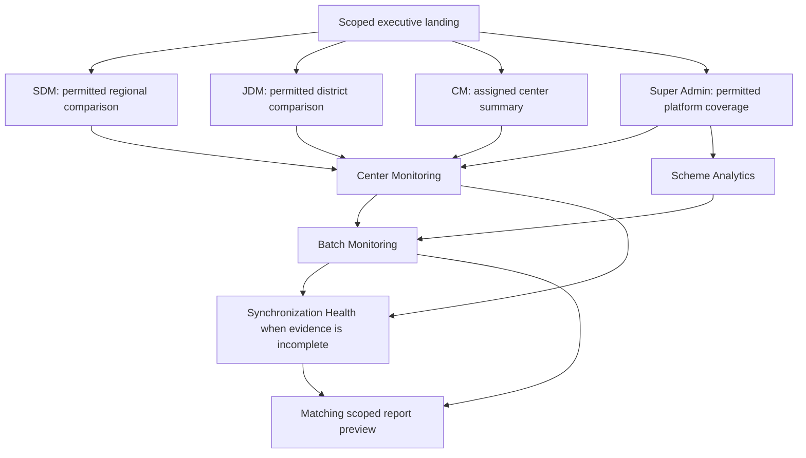
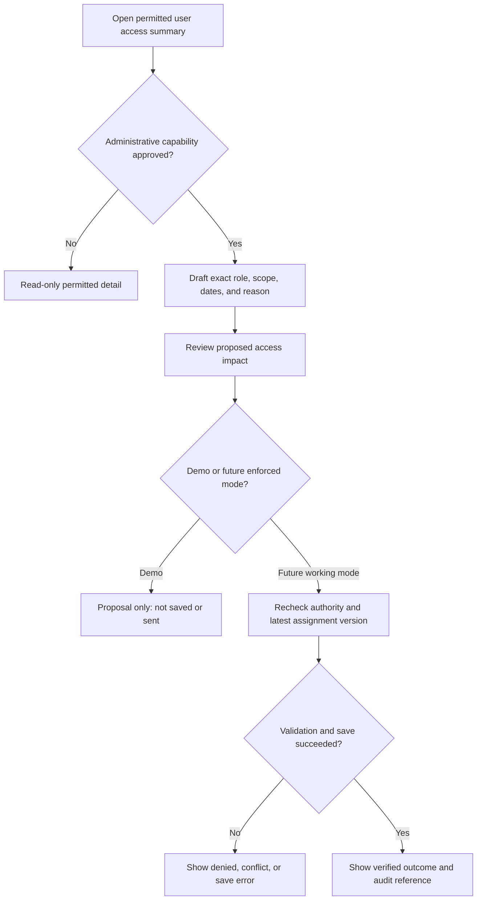

# Sarthak dashboard user flows

**Owner:** UI/UX Agent. **Reviewers:** Business Analyst, Product Manager, Security, Reporting, Analytics, Frontend, QA. **Status:** Proposed interaction journeys; no executable prototype. **Version:** 0.8. **Date:** 2026-10-14.

Flows use page IDs P-01–08 in [dashboard pages](dashboard-pages.md), [UI strategy](ui-strategy.md), and the existing [business workflows](business-workflows.md). The first four flows establish Super Admin, SDM, JDM, and CM experiences. Shared flows then cover schemes, reports, administration, and settings. All access and actions depend on approved assignments/capabilities, not titles alone.

## UF-01 Super Admin reviews platform coverage

**Actor:** Super Admin with permitted broad monitoring. **Entry:** P-01 Executive Dashboard. **Goal:** Explain a coverage or outcome exception with contributing evidence.

1. Read permitted scope, reporting dates, data-as-of, and source coverage; in demo mode confirm synthetic-data context.
2. Inspect center-network cards and KPI denominators; distinguish unknown classifications from inactive centers.
3. Compare regions or scheme coverage under the same context, using the chart's table alternative where needed.
4. Select an area to retain context in P-01/P-02, or a scheme to open P-04; inspect distinct center coverage and separately attributed batch outcomes.
5. Open the contributing center in P-02 and batch in P-03; use P-05 to qualify findings affected by stale/partial uploads.
6. Open the matching RPT-001, RPT-004, RPT-006, or RPT-008 preview in P-06 and verify scope/cutoff/coverage.

**Branches:** Unmapped geography stays in a labeled bucket. An unknown numerator/denominator is N/A, not an issue score. A forbidden detail is denied. **Exit:** A scoped finding and matching preview; no source record changes. **Trace:** US-SA-01–06; WF-01–07; UC-01–10 as applicable.

## UF-02 SDM investigates regional contributors

**Actor:** SDM with permitted regional/divisional assignments. **Entry:** P-01. **Goal:** Understand comparable regional indicators and district contributors.

1. Confirm assigned population; the page does not assume a division equals a region.
2. Choose compatible period/cohort, geography, and scheme filters, then Apply.
3. Compare indicators with sample sizes, denominators, and recording/sync coverage; inspect equivalent definitions.
4. Select a region to inspect its permitted districts in the P-01 comparison table, then a center in P-02. Blocks appear only where approved mappings exist.
5. Review contributing batch/outcome detail in P-03 or source coverage in P-05.
6. Open RPT-008 or RPT-007 in P-06 at the same publication; return restores the source view and focus.

**Branches:** Partial assigned coverage is labeled. Unsupported region comparison is replaced by an assigned-area summary, not a fabricated hierarchy. A new publication is optional explicit refresh, not a silent replacement. **Exit:** A defensible comparison with limitations. **Trace:** US-SDM-01–06; WF-03–07; UC-04–10.

## UF-03 JDM investigates district capacity

**Actor:** JDM with permitted district/operational assignments. **Entry:** P-01. **Goal:** Trace a district capacity/learning difference to authorized batches.

1. Confirm assigned district population and choose comparable reporting context.
2. Inspect district indicator rows and denominator/coverage details; avoid interpreting raw enrollment differences as rates.
3. Open a contributing center in P-02; retain geography/scheme/context.
4. Open P-03 batch detail and read eligible seats, capacity, excluded batches, enrollment/learner distinction, and source event dates.
5. Inspect Attendance, Assessments, Completion, or Certification tabs as relevant; use P-05 if observations are incomplete.
6. Open RPT-007 or RPT-005 in P-06 and compare values under the same filters/cutoff.

**Branches:** Missing capacity yields unavailable utilization. A repeated learner across batches counts once in the distinct-learner summary. A district selection cannot widen assignment scope. **Exit:** A traceable district/batch finding. **Trace:** US-JDM-01–06; WF-03–07; UC-04–10.

## UF-04 CM investigates attendance evidence

**Actor:** CM with assigned centers/clusters. **Entry:** P-01. **Goal:** Distinguish confirmed participation from missing observations.

1. Review local center/batch summary; a cluster is not presented as an automatic block or district.
2. Select a center in P-02 and a batch in P-03.
3. Open Attendance: inspect eligible opportunities, confirmed presence, known absence, unrecorded/unknown observations, and recording coverage.
4. If coverage is incomplete, open the same center's P-05 source observations and inspect last success, transfer outcome, freshness, and publication coverage separately.
5. Return to P-03 with the same snapshot; if newer received data exists, offer explicit refresh and explain a changed reporting cutoff.
6. Inspect outcome/certification tabs only where permitted, then open RPT-001 or RPT-006 in P-06.

**Branches:** Unknown attendance is not absence; a stale active center remains active. A device with no reported local backlog shows unknown, not zero. **Exit:** A participation finding that preserves observation limits. No attendance correction or Force sync action occurs. **Trace:** US-CM-01–06; WF-02–05/07; UC-02–07/10.

## UF-05 Compare scheme coverage and outcomes

**Actors:** All four roles within scope. **Entry:** P-04 or a scheme link from P-01/P-02. **Goal:** Understand category/scheme coverage without multiplying outcomes.

1. Inspect active category/scheme/geography filters and the pinned data context.
2. Read distinct-center membership coverage and its overlap/unassigned notice.
3. Open a category then scheme; inspect separate attributed-batch learning/capacity measures with their population labels.
4. Open participating centers in P-02 or attributed batches in P-03 using the explicit chosen population path.
5. Preview RPT-004 in P-06 with that context and definition set.

**Branches:** A center in two schemes is in both membership groups, but learning follows its batch's scheme assignment. Unknown batch scheme remains unassigned. **Exit:** Comparable scheme findings with overlap/coverage explained. **Trace:** REQ-006–014; RPT-004; WF-02–04/07.

## UF-06 Preview and optionally export a report

**Actors:** All four roles with report permission; export requires a separate capability. **Entry:** P-06 or a source-page report action. **Goal:** Produce a preview matching the source finding.

1. Select a permitted template, or accept the template/context carried from the source page.
2. Inspect filters, locked report status where applicable, period/cohort/cutoff, and data-as-of details; explain any unsupported filter removed during the transition.
3. Preview matching totals, definitions, coverage, and synthetic-data status.
4. Follow a permitted detail link or return to the source page; preserve its state.
5. If executable export is available, choose an approved format and request the full authorized filtered result, respecting disclosed limits. Otherwise show Preview only or a labeled nonpersistent export demonstration.
6. Display ready/failed/expired/partial states only according to future evidence; verify access again at download.

**Branches:** Newer data does not silently replace the source snapshot. An out-of-scope report is denied; a failed export never shows Download complete. **Exit:** Matching preview, or separately approved future artifact. **Trace:** REQ-018; UC-10; WF-07; RPT-001–008.

## UF-07 Design a scheduled report

**Actors:** Any role with an explicitly approved future scheduling capability. **Entry:** P-06 schedule design panel. **Goal:** Review recurrence and recipient-scoped reporting behavior.

1. Choose a permitted template, supported formats, requested scope, and filters.
2. Review recurrence, reporting timezone, business period/cohort, evaluation cutoff, snapshot freeze/wait policy, and registered recipients.
3. Show each recipient's permitted-scope intersection and explain that narrower recipients receive their own result.
4. Review a sample next occurrence/metadata and missing-data, expiry, retry, and missed-run behavior.
5. In this demonstration design, mark the result Proposed schedule — not active. A future working Save requires current authorization and recorded configuration/version evidence.
6. Future schedule history distinguishes paused/suspended/retired configuration from run generation and notification outcomes; changes/retries recheck permissions.

**Branches:** Invalid timezone/recipient/scope blocks activation; revoked owner/recipient prevents generation/delivery/access. No actual email or schedule is created. **Exit:** A reviewable proposed configuration. **Trace:** [Reporting strategy](reporting-strategy.md), DEC-020.

## UF-08 Review or propose user access changes

**Actor:** Super Admin or another principal only if directory/administration is explicitly delegated. **Entry:** P-07; excluded from other roles' default navigation. **Goal:** Understand permitted user access and safely review a proposed change.

1. Enter the separate administrative context; monitoring date/scheme filters do not affect the directory.
2. Search/filter permitted user metadata and open an access summary.
3. Read current roles, allowed scopes/effective dates, account state, and permitted change history. Do not disclose unseen broader assignments.
4. If separately permitted, draft an approved role/scope assignment, revocation, account disablement, or identity-onboarding handoff with a reason. Blank scope is invalid, not global.
5. Review current-versus-proposed access and effects on reports/schedules. Self-affecting/privileged changes require the future policy decision; do not assume title-based authority.
6. In demo mode show Proposed change — not saved/not sent. A future implementation rechecks authority and assignment version, persists with audit evidence, and shows success only after a verified save.

**Branches:** No directory capability → no page data. Read-only capability → no edit. Conflicting assignment version → inspect latest approved state before retry. Cancel retains original access. Invalid scope/duplicate effective grant blocks submission. **Exit:** Permitted access review or clearly labeled proposal; no actual provisioning. **Trace:** P-07; A-27; extends earlier monitoring-only use cases.

## UF-09 Preview or save personal settings

**Actors:** Super Admin, SDM, JDM, CM. **Entry:** P-08 Personal Preferences. **Goal:** Adjust presentation without changing KPI meaning or authority.

1. Read current personal preference values and the separately visible reporting timezone.
2. Change supported density/date/number/display-time options; view a local example and an unsaved-state indicator.
3. Validate supported values; display-timezone choice does not alter business calendar/cohort calculations.
4. Preview or cancel. In a nonpersistent demonstration show Preference preview — not saved; only a future verified persistence response shows Saved.
5. Attempting to leave a dirty form offers continue editing or discard draft; returning retains only legitimately persisted values or explicitly local demo state.

**Branches:** Unsupported language/theme controls are absent or labeled proposals. Save failure preserves the draft with an error; preferences cannot grant exports/schedules or access. **Exit:** A presentation preview or future verified personal preference. **Trace:** P-08; A-23/A-27.

## UF-10 Inspect or propose reporting/data policy settings

**Actor:** All roles may see permitted read-only policy reference; proposing changes requires explicit authority. **Entry:** P-08 Data and Reporting Policy. **Goal:** Understand rules and review the impact of a policy proposal.

1. Read the approved/pending reporting timezone, classification, sync cadence, and relevant export/retention policy labels.
2. If authorized, draft a specific proposed policy revision and reason; show effects on metric definitions, historical comparability, reports, and schedules.
3. Review affected examples and required business/domain reviewers. A visual toggle does not activate a KPI rule or rewrite historical reports.
4. In this phase, mark Proposal only. A future working policy-review workflow needs a separate requirement, approved permission model, versioned activation, and audit trail.
5. Cancel returns to the current policy without a false success message.

**Branches:** Policy pending shows no invented default; denied change permission leaves the section read-only. Concurrent policy changes require re-review rather than blind overwrite. **Exit:** Policy understanding or a nonactive proposal. **Trace:** P-08; A-27; DEC-006–007/020.

## UF-11 Recover from data or access changes

**Actors:** All four roles. **Entry:** Any monitoring view or detail. **Goal:** Retain useful context without exposing invalid or mixed data.

1. Loading retains the visible committed context. A new filter/snapshot request is marked pending separately.
2. Empty results offer supported reset; unknown/partial source data shows coverage; retrieval failure offers retry without claiming latest data.
3. If newer received data exists, explicit refresh updates all dependent views together; reports pinned earlier remain identified with their original data-as-of.
4. On session expiry or permission change in enforced mode, clear affected sensitive content and show sign-in/access state. A bookmarked forbidden detail cannot fall back to a broader dataset.
5. Return/retry restores only context still allowed by current authority; keyboard focus returns to a meaningful heading or control.

**Exit:** A coherent current or clearly stale view, or an explicit unavailable/denied state. **Trace:** REQ-001–002/019–022; shared AC-C01–09.

## Flow review checklist

Review every role's primary journey, all eight page transitions, filter/back/focus continuity, unknown/offline narratives, template parity, read-only versus administrative paths, and demo labels. Use synthetic scenarios with overlap, missing capacity, unrecorded attendance, pending grading, completion without certificate, partial/late sync, forbidden detail, and assignment conflict. These are future design/validation checks, not executed user tests or live workflows.
